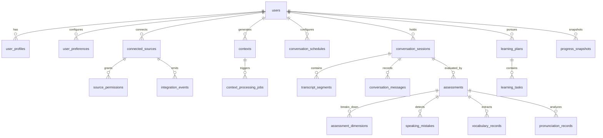

# STEP 01 — PRODUCT REQUIREMENTS & SYSTEM ARCHITECTURE
## Complete Implementation-Ready Engineering Specification & Architectural Blueprint

**Project:** AI-Powered Personal English Intelligence & Learning System  
**Module:** Android Mobile Application  
**Phase:** 01 of 08 (Foundation)  
**Architecture:** Clean Architecture + MVI (Android), Modular Monolith (FastAPI Backend), Hybrid Relational + Context Storage (PostgreSQL)  
**Primary AI Engine:** Google Gemini (Abstracted via Provider SPI)  
**Document Status:** Implementation-Ready Blueprint & Engineering Contract  

---

## 1. TECHNICAL REQUIREMENTS ANALYSIS & SYSTEM DECOMPOSITION

### 1.1 Core Engineering Areas (8 Areas)
1. **User Identity & Cognitive Profile Management:** Multi-device user profiles, localized baseline proficiency (CEFR A1–C2), speaking goals (Corporate, FAANG Interview, IELTS 7.5+, Executive).
2. **Connected Mobile Sources & Permission Orchestration:** Android permission lifecycles, explicit source capabilities (ShareSheet, Notification Listener, Usage Access, Calendar Resolver), and immediate data collection termination upon revocation.
3. **Context Extraction, Normalization & Semantic Ingestion:** Non-invasive context ingestion pipeline with metadata attribution (source, timestamp, hash), validation, sanitization, and embedding preparation.
4. **Smart Scheduling & Proactive Session Engine:** Exact time and window-based scheduling leveraging Android `AlarmManager` (`setExactAndAllowWhileIdle`) + `WorkManager` fallback, generating actionable push notifications with relevant conversation hooks.
5. **Real-Time Voice Conversation & Streaming Audio Pipeline:** Low-latency bidirectional audio streaming over WSS/WebRTC, Voice Activity Detection (VAD), client-side Opus compression, and foreground service lifecycle.
6. **Transcript Serialization & Multi-Speaker Turn Tracking:** Timestamped conversational turn tracking with sequence numbering, confidence scoring, and partial-to-final transcript promotion.
7. **Multi-Dimensional English Assessment Engine:** Evidence-grounded evaluation across Grammar, Lexical Resource, Fluency & Coherence, and Acoustic/Phonetic Pronunciation using raw audio evidence.
8. **Personal Learning Memory & Adaptive Roadmap:** Long-term mistake consolidation, spaced repetition error tracking, and dynamic learning milestone generation.

---

## 2. COMPREHENSIVE DATABASE ERD & RELATIONAL SCHEMA

PostgreSQL 16+ relational schema with native UUID primary keys, transactional integrity, soft delete where auditable, and GIN/B-Tree indexing.



### 2.1 Complete Relational Table Definitions (DDL Specification)

```sql
-- Extensions
CREATE EXTENSION IF NOT EXISTS "uuid-ossp";
CREATE EXTENSION IF NOT EXISTS "pgcrypto";

-- ============================================================================
-- 1. USER & PROFILE MANAGEMENT
-- ============================================================================

CREATE TABLE users (
    id UUID PRIMARY KEY DEFAULT gen_random_uuid(),
    email VARCHAR(255) NOT NULL UNIQUE,
    password_hash VARCHAR(255) NOT NULL,
    full_name VARCHAR(120) NOT NULL,
    status VARCHAR(32) NOT NULL DEFAULT 'active' CHECK (status IN ('active', 'suspended', 'deactivated')),
    created_at TIMESTAMPTZ NOT NULL DEFAULT CURRENT_TIMESTAMP,
    updated_at TIMESTAMPTZ NOT NULL DEFAULT CURRENT_TIMESTAMP
);

CREATE TABLE user_profiles (
    user_id UUID PRIMARY KEY REFERENCES users(id) ON DELETE CASCADE,
    native_language VARCHAR(10) NOT NULL DEFAULT 'bn',
    target_cefr_level VARCHAR(4) NOT NULL DEFAULT 'B2' CHECK (target_cefr_level IN ('A1', 'A2', 'B1', 'B2', 'C1', 'C2')),
    current_cefr_estimate VARCHAR(4) DEFAULT 'B1',
    daily_speaking_goal_minutes INT NOT NULL DEFAULT 15,
    avatar_url TEXT,
    created_at TIMESTAMPTZ NOT NULL DEFAULT CURRENT_TIMESTAMP,
    updated_at TIMESTAMPTZ NOT NULL DEFAULT CURRENT_TIMESTAMP
);

CREATE TABLE user_preferences (
    user_id UUID PRIMARY KEY REFERENCES users(id) ON DELETE CASCADE,
    ai_persona VARCHAR(32) NOT NULL DEFAULT 'supportive_coach' CHECK (ai_persona IN ('supportive_coach', 'strict_examiner', 'business_colleague', 'casual_friend')),
    ai_accent VARCHAR(16) NOT NULL DEFAULT 'us_neutral' CHECK (ai_accent IN ('us_neutral', 'uk_oxford', 'aus_sydney')),
    speaking_speed_factor NUMERIC(3, 2) NOT NULL DEFAULT 1.00 CHECK (speaking_speed_factor BETWEEN 0.70 AND 1.30),
    haptic_feedback_enabled BOOLEAN NOT NULL DEFAULT TRUE,
    notifications_enabled BOOLEAN NOT NULL DEFAULT TRUE,
    data_retention_days INT NOT NULL DEFAULT 90,
    created_at TIMESTAMPTZ NOT NULL DEFAULT CURRENT_TIMESTAMP,
    updated_at TIMESTAMPTZ NOT NULL DEFAULT CURRENT_TIMESTAMP
);

-- ============================================================================
-- 2. CONNECTED SOURCES & PERMISSION AUDIT
-- ============================================================================

CREATE TABLE connected_sources (
    id UUID PRIMARY KEY DEFAULT gen_random_uuid(),
    user_id UUID NOT NULL REFERENCES users(id) ON DELETE CASCADE,
    source_type VARCHAR(64) NOT NULL CHECK (source_type IN ('share_sheet', 'notification_listener', 'usage_access', 'calendar_resolver', 'manual_prompt')),
    source_identifier VARCHAR(128) NOT NULL, -- e.g., 'android.package.com.slack' or 'device_calendar'
    is_active BOOLEAN NOT NULL DEFAULT TRUE,
    last_synced_at TIMESTAMPTZ,
    created_at TIMESTAMPTZ NOT NULL DEFAULT CURRENT_TIMESTAMP,
    updated_at TIMESTAMPTZ NOT NULL DEFAULT CURRENT_TIMESTAMP,
    CONSTRAINT uq_user_source UNIQUE (user_id, source_type, source_identifier)
);

CREATE TABLE source_permissions (
    id UUID PRIMARY KEY DEFAULT gen_random_uuid(),
    source_id UUID NOT NULL REFERENCES connected_sources(id) ON DELETE CASCADE,
    android_permission VARCHAR(128) NOT NULL,
    is_granted BOOLEAN NOT NULL DEFAULT FALSE,
    granted_at TIMESTAMPTZ,
    revoked_at TIMESTAMPTZ,
    updated_at TIMESTAMPTZ NOT NULL DEFAULT CURRENT_TIMESTAMP
);

CREATE TABLE consent_records (
    id UUID PRIMARY KEY DEFAULT gen_random_uuid(),
    user_id UUID NOT NULL REFERENCES users(id) ON DELETE CASCADE,
    consent_topic VARCHAR(64) NOT NULL, -- 'ai_data_processing', 'audio_recording', 'context_ingestion'
    version VARCHAR(16) NOT NULL,
    granted BOOLEAN NOT NULL DEFAULT TRUE,
    ip_address INET,
    user_agent TEXT,
    created_at TIMESTAMPTZ NOT NULL DEFAULT CURRENT_TIMESTAMP
);

-- ============================================================================
-- 3. CONTEXT MANAGEMENT
-- ============================================================================

CREATE TABLE contexts (
    id UUID PRIMARY KEY DEFAULT gen_random_uuid(),
    user_id UUID NOT NULL REFERENCES users(id) ON DELETE CASCADE,
    source_id UUID REFERENCES connected_sources(id) ON DELETE SET NULL,
    category VARCHAR(64) NOT NULL CHECK (category IN ('meeting_prep', 'daily_task', 'tech_topic', 'article_summary', 'professional_email', 'general_reflection')),
    title VARCHAR(255) NOT NULL,
    raw_content TEXT NOT NULL,
    sanitized_summary TEXT,
    extracted_keywords JSONB NOT NULL DEFAULT '[]'::jsonb,
    suggested_conversation_hooks JSONB NOT NULL DEFAULT '[]'::jsonb,
    content_hash CHAR(64) NOT NULL, -- SHA-256 for duplicate detection
    is_used_in_session BOOLEAN NOT NULL DEFAULT FALSE,
    expires_at TIMESTAMPTZ,
    created_at TIMESTAMPTZ NOT NULL DEFAULT CURRENT_TIMESTAMP
);

CREATE INDEX idx_contexts_user_hash ON contexts(user_id, content_hash);
CREATE INDEX idx_contexts_freshness ON contexts(user_id, is_used_in_session, created_at DESC);

-- ============================================================================
-- 4. CONVERSATION SCHEDULING
-- ============================================================================

CREATE TABLE conversation_schedules (
    id UUID PRIMARY KEY DEFAULT gen_random_uuid(),
    user_id UUID NOT NULL REFERENCES users(id) ON DELETE CASCADE,
    schedule_type VARCHAR(32) NOT NULL CHECK (schedule_type IN ('fixed_time', 'interval', 'context_triggered')),
    target_time_local TIME, -- e.g., '18:30:00'
    days_of_week INT[] NOT NULL DEFAULT '{1,2,3,4,5}', -- 1=Monday, 7=Sunday
    interval_hours INT,
    preferred_duration_minutes INT NOT NULL DEFAULT 10,
    is_active BOOLEAN NOT NULL DEFAULT TRUE,
    created_at TIMESTAMPTZ NOT NULL DEFAULT CURRENT_TIMESTAMP,
    updated_at TIMESTAMPTZ NOT NULL DEFAULT CURRENT_TIMESTAMP
);

CREATE TABLE scheduled_events (
    id UUID PRIMARY KEY DEFAULT gen_random_uuid(),
    schedule_id UUID NOT NULL REFERENCES conversation_schedules(id) ON DELETE CASCADE,
    user_id UUID NOT NULL REFERENCES users(id) ON DELETE CASCADE,
    context_id UUID REFERENCES contexts(id) ON DELETE SET NULL,
    scheduled_for TIMESTAMPTZ NOT NULL,
    status VARCHAR(32) NOT NULL DEFAULT 'pending' CHECK (status IN ('pending', 'notified', 'accepted', 'missed', 'cancelled')),
    notification_sent_at TIMESTAMPTZ,
    responded_at TIMESTAMPTZ,
    created_at TIMESTAMPTZ NOT NULL DEFAULT CURRENT_TIMESTAMP
);

CREATE INDEX idx_scheduled_events_trigger ON scheduled_events(status, scheduled_for);

-- ============================================================================
-- 5. CONVERSATION & TRANSCRIPTION
-- ============================================================================

CREATE TABLE conversation_sessions (
    id UUID PRIMARY KEY DEFAULT gen_random_uuid(),
    user_id UUID NOT NULL REFERENCES users(id) ON DELETE CASCADE,
    context_id UUID REFERENCES contexts(id) ON DELETE SET NULL,
    scheduled_event_id UUID REFERENCES scheduled_events(id) ON DELETE SET NULL,
    topic_title VARCHAR(255) NOT NULL,
    status VARCHAR(32) NOT NULL DEFAULT 'active' CHECK (status IN ('active', 'completed', 'interrupted', 'abandoned')),
    started_at TIMESTAMPTZ NOT NULL DEFAULT CURRENT_TIMESTAMP,
    ended_at TIMESTAMPTZ,
    duration_seconds INT DEFAULT 0,
    user_speaking_seconds INT DEFAULT 0,
    ai_speaking_seconds INT DEFAULT 0,
    turn_count INT NOT NULL DEFAULT 0,
    audio_sample_rate INT DEFAULT 16000,
    audio_channel_count INT DEFAULT 1,
    client_app_version VARCHAR(32),
    created_at TIMESTAMPTZ NOT NULL DEFAULT CURRENT_TIMESTAMP
);

CREATE TABLE transcript_segments (
    id UUID PRIMARY KEY DEFAULT gen_random_uuid(),
    session_id UUID NOT NULL REFERENCES conversation_sessions(id) ON DELETE CASCADE,
    turn_index INT NOT NULL,
    speaker VARCHAR(16) NOT NULL CHECK (speaker IN ('user', 'ai')),
    start_ms INT NOT NULL,
    end_ms INT NOT NULL,
    text TEXT NOT NULL,
    confidence NUMERIC(4, 3) DEFAULT 1.000,
    audio_chunk_ref TEXT, -- Optional pointer to temporary audio storage if retained
    created_at TIMESTAMPTZ NOT NULL DEFAULT CURRENT_TIMESTAMP,
    CONSTRAINT uq_session_turn UNIQUE (session_id, turn_index)
);

CREATE INDEX idx_transcripts_session_order ON transcript_segments(session_id, turn_index ASC);

-- ============================================================================
-- 6. MULTI-DIMENSIONAL ASSESSMENT & MISTAKE REPOSITORY
-- ============================================================================

CREATE TABLE assessments (
    id UUID PRIMARY KEY DEFAULT gen_random_uuid(),
    session_id UUID NOT NULL UNIQUE REFERENCES conversation_sessions(id) ON DELETE CASCADE,
    user_id UUID NOT NULL REFERENCES users(id) ON DELETE CASCADE,
    overall_cefr_score VARCHAR(4) NOT NULL,
    grammar_score NUMERIC(4, 1) NOT NULL, -- 0 - 100
    vocabulary_score NUMERIC(4, 1) NOT NULL,
    fluency_score NUMERIC(4, 1) NOT NULL,
    pronunciation_score NUMERIC(4, 1) NOT NULL,
    words_per_minute INT NOT NULL DEFAULT 0,
    filler_word_count INT NOT NULL DEFAULT 0,
    total_pause_seconds NUMERIC(5, 2) NOT NULL DEFAULT 0.0,
    ai_feedback_summary TEXT NOT NULL,
    created_at TIMESTAMPTZ NOT NULL DEFAULT CURRENT_TIMESTAMP
);

CREATE TABLE speaking_mistakes (
    id UUID PRIMARY KEY DEFAULT gen_random_uuid(),
    assessment_id UUID NOT NULL REFERENCES assessments(id) ON DELETE CASCADE,
    user_id UUID NOT NULL REFERENCES users(id) ON DELETE CASCADE,
    transcript_segment_id UUID REFERENCES transcript_segments(id) ON DELETE CASCADE,
    mistake_category VARCHAR(32) NOT NULL CHECK (mistake_category IN ('grammar', 'vocabulary', 'pronunciation', 'syntax', 'filler_excess')),
    original_text TEXT NOT NULL,
    corrected_text TEXT NOT NULL,
    explanation TEXT NOT NULL,
    severity VARCHAR(16) NOT NULL CHECK (severity IN ('low', 'medium', 'high')),
    audio_timestamp_ms INT,
    created_at TIMESTAMPTZ NOT NULL DEFAULT CURRENT_TIMESTAMP
);

CREATE INDEX idx_speaking_mistakes_user_category ON speaking_mistakes(user_id, mistake_category, created_at DESC);

CREATE TABLE pronunciation_records (
    id UUID PRIMARY KEY DEFAULT gen_random_uuid(),
    assessment_id UUID NOT NULL REFERENCES assessments(id) ON DELETE CASCADE,
    user_id UUID NOT NULL REFERENCES users(id) ON DELETE CASCADE,
    word VARCHAR(64) NOT NULL,
    target_phonemes VARCHAR(64) NOT NULL,
    detected_phonemes VARCHAR(64) NOT NULL,
    phoneme_score NUMERIC(4, 1) NOT NULL, -- 0 - 100
    audio_sample_url TEXT,
    created_at TIMESTAMPTZ NOT NULL DEFAULT CURRENT_TIMESTAMP
);

-- ============================================================================
-- 7. PERSONAL LEARNING MEMORY & PROGRESS TRACKING
-- ============================================================================

CREATE TABLE learning_plans (
    id UUID PRIMARY KEY DEFAULT gen_random_uuid(),
    user_id UUID NOT NULL REFERENCES users(id) ON DELETE CASCADE,
    title VARCHAR(255) NOT NULL,
    focus_areas JSONB NOT NULL DEFAULT '[]'::jsonb,
    is_active BOOLEAN NOT NULL DEFAULT TRUE,
    created_at TIMESTAMPTZ NOT NULL DEFAULT CURRENT_TIMESTAMP,
    updated_at TIMESTAMPTZ NOT NULL DEFAULT CURRENT_TIMESTAMP
);

CREATE TABLE learning_tasks (
    id UUID PRIMARY KEY DEFAULT gen_random_uuid(),
    plan_id UUID NOT NULL REFERENCES learning_plans(id) ON DELETE CASCADE,
    task_type VARCHAR(64) NOT NULL CHECK (task_type IN ('quick_drill', 'targeted_topic', 'pronunciation_repetition', 'idiom_application')),
    prompt TEXT NOT NULL,
    target_mistake_category VARCHAR(32),
    is_completed BOOLEAN NOT NULL DEFAULT FALSE,
    completed_at TIMESTAMPTZ,
    created_at TIMESTAMPTZ NOT NULL DEFAULT CURRENT_TIMESTAMP
);

CREATE TABLE progress_snapshots (
    id UUID PRIMARY KEY DEFAULT gen_random_uuid(),
    user_id UUID NOT NULL REFERENCES users(id) ON DELETE CASCADE,
    snapshot_date DATE NOT NULL,
    rolling_cefr_estimate VARCHAR(4) NOT NULL,
    avg_grammar_score NUMERIC(4, 1) NOT NULL,
    avg_vocabulary_score NUMERIC(4, 1) NOT NULL,
    avg_fluency_score NUMERIC(4, 1) NOT NULL,
    avg_pronunciation_score NUMERIC(4, 1) NOT NULL,
    total_speaking_minutes INT NOT NULL DEFAULT 0,
    active_streak_days INT NOT NULL DEFAULT 0,
    created_at TIMESTAMPTZ NOT NULL DEFAULT CURRENT_TIMESTAMP,
    CONSTRAINT uq_user_snapshot_date UNIQUE (user_id, snapshot_date)
);

-- ============================================================================
-- 8. SYSTEM RELIABILITY, SYNC & IDEMPOTENCY
-- ============================================================================

CREATE TABLE idempotency_records (
    key VARCHAR(128) PRIMARY KEY,
    user_id UUID NOT NULL REFERENCES users(id) ON DELETE CASCADE,
    resource_type VARCHAR(64) NOT NULL,
    response_code INT NOT NULL,
    response_payload JSONB NOT NULL,
    created_at TIMESTAMPTZ NOT NULL DEFAULT CURRENT_TIMESTAMP,
    expires_at TIMESTAMPTZ NOT NULL
);

CREATE TABLE audit_logs (
    id UUID PRIMARY KEY DEFAULT gen_random_uuid(),
    user_id UUID REFERENCES users(id) ON DELETE SET NULL,
    action VARCHAR(64) NOT NULL,
    ip_address INET,
    user_agent TEXT,
    payload JSONB,
    created_at TIMESTAMPTZ NOT NULL DEFAULT CURRENT_TIMESTAMP
);

CREATE INDEX idx_audit_logs_user_time ON audit_logs(user_id, created_at DESC);
```

---

## 3. COMPLETE REST & WEBSOCKET API CONTRACT SPECIFICATION (`/api/v1`)

### 3.1 Standard JSON Envelopes

#### Success Envelope
```json
{
  "success": true,
  "data": {},
  "meta": {
    "request_id": "req_01HPX789ABCD",
    "timestamp": "2026-11-21T12:00:00Z"
  }
}
```

#### Error Envelope
```json
{
  "success": false,
  "error": {
    "error_code": "RESOURCE_DUPLICATE_ERROR",
    "message": "This context content has already been ingested.",
    "details": { "content_hash": "e3b0c44298fc1c149afbf4c8996fb92427ae41e4649b934ca495991b7852b855" },
    "request_id": "req_01HPX789ABCD",
    "retryable": false
  }
}
```

### 3.2 Endpoint Specifications

| Domain | Method & Path | Auth | Description | Idempotent |
|---|---|---|---|---|
| **Auth** | `POST /api/v1/auth/register` | None | Create new user account | Yes (by Email) |
| **Auth** | `POST /api/v1/auth/login` | None | Exchange credentials for JWT access/refresh pair | No |
| **Auth** | `POST /api/v1/auth/refresh` | Refresh Token | Refresh expired access token | No |
| **Auth** | `POST /api/v1/auth/logout` | Bearer Token | Invalidate active session & tokens | Yes |
| **Profile** | `GET /api/v1/users/me/profile` | Bearer Token | Fetch user profile, CEFR level, target goals | Yes |
| **Profile** | `PUT /api/v1/users/me/profile` | Bearer Token | Update goals, target CEFR, daily speaking quota | Yes |
| **Profile** | `GET /api/v1/users/me/preferences` | Bearer Token | Retrieve AI coach persona, accent, speed | Yes |
| **Profile** | `PUT /api/v1/users/me/preferences` | Bearer Token | Update coach persona, accent, speed | Yes |
| **Sources** | `GET /api/v1/sources` | Bearer Token | List all connected mobile source adapters | Yes |
| **Sources** | `POST /api/v1/sources/connect` | Bearer Token | Connect mobile source (ShareSheet, Calendar, etc.) | Yes |
| **Sources** | `DELETE /api/v1/sources/{source_id}/revoke` | Bearer Token | Revoke source & purge pending source context | Yes |
| **Context** | `POST /api/v1/contexts/ingest` | Bearer Token | Ingest validated & sanitized context record | Header: `Idempotency-Key` |
| **Context** | `GET /api/v1/contexts` | Bearer Token | Retrieve fresh, unused contexts for session prep | Yes |
| **Context** | `DELETE /api/v1/contexts/{context_id}` | Bearer Token | Remove specific context item | Yes |
| **Schedule** | `GET /api/v1/schedules` | Bearer Token | Retrieve configured conversation schedules | Yes |
| **Schedule** | `POST /api/v1/schedules` | Bearer Token | Create fixed-time or interval schedule | Header: `Idempotency-Key` |
| **Schedule** | `PUT /api/v1/schedules/{schedule_id}` | Bearer Token | Update schedule timing, status, days | Yes |
| **Schedule** | `DELETE /api/v1/schedules/{schedule_id}` | Bearer Token | Delete schedule | Yes |
| **Conversation** | `POST /api/v1/conversations/initiate` | Bearer Token | Prepare session topic, questions from context | Header: `Idempotency-Key` |
| **Conversation** | `WS /api/v1/conversations/{session_id}/voice` | Bearer Token | Full-duplex audio stream, VAD, dialogue turns | Streaming |
| **Conversation** | `POST /api/v1/conversations/{session_id}/complete` | Bearer Token | Finalize session, commit duration & turns | Yes |
| **Transcript** | `GET /api/v1/conversations/{session_id}/transcript` | Bearer Token | Retrieve turn-by-turn timestamped transcript | Yes |
| **Transcript** | `POST /api/v1/conversations/{session_id}/transcript/sync` | Bearer Token | Bulk-sync offline buffered transcript turns | Header: `Idempotency-Key` |
| **Assessment** | `GET /api/v1/conversations/{session_id}/assessment` | Bearer Token | Fetch CEFR score, metrics, linguistic breakdown | Yes |
| **Assessment** | `GET /api/v1/assessments/mistakes` | Bearer Token | Query historical mistake library with filters | Yes |
| **Learning** | `GET /api/v1/learning/plan` | Bearer Token | Fetch personalized active roadmap & drills | Yes |
| **Learning** | `PUT /api/v1/learning/tasks/{task_id}/complete` | Bearer Token | Mark adaptive drill complete | Yes |
| **Progress** | `GET /api/v1/progress/snapshots` | Bearer Token | Fetch historical CEFR progression and streaks | Yes |

---

## 4. ANDROID NATIVE & BACKEND MODULE ARCHITECTURE

### 4.1 Android Native Module Tree (`app/`)
```
app/
├── src/main/java/com/fluentmeet/ai/
│   ├── presentation/                 # Jetpack Compose UI & ViewModels
│   │   ├── navigation/               # NavHost, SafeArgs, DeepLink routing
│   │   ├── theme/                    # Color, Type, Shape, Elevation
│   │   ├── components/               # Design-system buttons, cards, waveforms
│   │   ├── auth/                     # LoginScreen, RegisterScreen, ForgotPassword
│   │   ├── onboarding/               # GoalSelector, CEFRBaseline, SourceConnectScreen
│   │   ├── home/                     # DailyGoalCard, ScheduleWidget, NextTopicCard
│   │   ├── conversation/             # VoiceCallScreen, LiveWaveform, InterruptionControl
│   │   ├── assessment/               # SessionReportScreen, ScoreRadar, MistakeInspector
│   │   ├── mistakes/                 # MistakeLibraryScreen, SpacedRepetitionDrills
│   │   └── settings/                 # SourcePermissionsScreen, CoachPersonaScreen
│   │
│   ├── domain/                       # Core Business Logic & UseCases
│   │   ├── model/                    # Immutable domain models (User, Session, Mistake)
│   │   ├── usecase/
│   │   │   ├── auth/                 # LoginUseCase, RefreshTokenUseCase
│   │   │   ├── context/              # IngestShareSheetContextUseCase, SanitizeContextUseCase
│   │   │   ├── schedule/             # CalculateNextTriggerUseCase, SyncAlarmsUseCase
│   │   │   ├── conversation/         # StartVoiceSessionUseCase, SendAudioChunkUseCase
│   │   │   └── assessment/           # GetSessionReportUseCase, GetLearningPlanUseCase
│   │   └── repository/               # Clean interfaces (UserRepository, SessionRepository)
│   │
│   ├── data/                         # Concrete Repositories & Data Sources
│   │   ├── local/
│   │   │   ├── database/             # Room: FluentMeetDatabase, Migrations
│   │   │   ├── dao/                  # SessionDao, TranscriptDao, ContextDao
│   │   │   ├── entity/               # Room entities mapping local storage
│   │   │   └── datastore/            # UserPreferencesDataStore, TokenStore
│   │   ├── remote/
│   │   │   ├── api/                  # Ktor/Retrofit: FluentMeetApiService
│   │   │   ├── websocket/            # VoiceWebSocketClient (WSS streaming)
│   │   │   ├── dto/                  # Request / Response JSON DTOs
│   │   │   └── mapper/               # DTO <-> Domain entity converters
│   │   └── repository/               # Offline-first repository implementations
│   │
│   ├── integration/                  # Android Source Connectors
│   │   ├── sharesheet/               # SendActionReceiver, TextExtractor
│   │   ├── notification/             # AppNotificationListenerService
│   │   ├── usage/                    # AppUsageStatsProvider (whitelist-only)
│   │   └── calendar/                 # CalendarEventResolver
│   │
│   ├── audio/                        # Hardware Audio Engine
│   │   ├── recorder/                 # AudioRecord (16kHz, 16-bit PCM Mono)
│   │   ├── encoder/                  # Opus hardware/software compression codec
│   │   ├── vad/                      # Voice Activity Detector (Silero/WebRTC VAD)
│   │   ├── player/                   # AudioTrack streaming playback with jitter buffer
│   │   └── service/                  # VoiceCallForegroundService (ongoing mic notification)
│   │
│   ├── scheduler/                    # Scheduling & Work Coordination
│   │   ├── alarm/                    # ExactAlarmReceiver, AlarmScheduler
│   │   ├── worker/                   # SyncWorker, ContextPurgeWorker (WorkManager)
│   │   └── notification/             # SessionNotificationManager (CallStyle notifications)
│   │
│   ├── synchronization/              # Offline-first Synchronization Engine
│   │   ├── queue/                    # Persistent sync queue with exponential backoff
│   │   └── reconciler/               # Local-remote conflict resolver
│   │
│   ├── security/                     # Mobile Security Layer
│   │   ├── crypto/                   # Android KeyStore, EncryptedSharedPreferences
│   │   └── network/                  # Certificate pinner, SSLSocketFactory
│   │
│   └── core/                         # Utilities & Cross-Cutting Helpers
│       ├── result/                   # Result<T, Error> functional wrapper
│       ├── dispatcher/               # CoroutineDispatcherProvider (Main, IO, Default)
│       └── logger/                   # Structured file & crash reporting
```

### 4.2 Backend Architecture Tree (`backend/`)
```
backend/
├── app/
│   ├── core/
│   │   ├── config.py                 # Pydantic Settings (ENV, DB, Gemini Keys)
│   │   ├── database.py               # Async SQLAlchemy / asyncpg engine
│   │   ├── security.py               # JWT decode, Argon2 password hashing
│   │   └── exceptions.py             # Custom API exceptions & global handlers
│   │
│   ├── api/
│   │   ├── v1/
│   │   │   ├── router.py             # Root v1 APIRouter aggregator
│   │   │   └── endpoints/            # auth, profile, sources, contexts, conversations
│   │   └── websockets/
│   │       └── voice_stream.py       # Full-duplex binary audio WSS endpoint
│   │
│   ├── modules/                      # Domain Feature Implementations
│   │   ├── auth/                     # Service, Repository, Schemas
│   │   ├── users/
│   │   ├── sources/
│   │   ├── contexts/
│   │   ├── schedules/
│   │   ├── conversations/
│   │   ├── transcripts/
│   │   ├── assessments/
│   │   └── learning/
│   │
│   ├── ai/                           # AI Engine & Provider SPI
│   │   ├── base.py                   # Provider interfaces (STT, TTS, LLM, Pronunciation)
│   │   ├── providers/
│   │   │   ├── gemini_live.py        # Gemini Live API bidirectional audio/text
│   │   │   ├── gemini_linguistic.py  # Structured CEFR & Grammar evaluation
│   │   │   └── acoustic_evaluator.py # Phoneme-level acoustic audio analyzer
│   │   └── prompts/                  # Versioned prompt templates
│   │
│   └── workers/                      # Asynchronous Background Tasks
│       ├── celery_app.py
│       └── tasks/                    # context_processor, assessment_generator
│
├── migrations/                       # Alembic schema migration versions
└── tests/                            # Unit, integration, and E2E API tests
```

---

## 5. AI PROVIDER ABSTRACTION LAYER (SPI)

To prevent vendor lock-in to Google Gemini and ensure zero business-logic coupling, all AI operations are mediated by strict domain interfaces:

```python
# app/ai/base.py
from abc import ABC, abstractmethod
from typing import AsyncGenerator, List, Dict, Any

class SpeechRecognitionProvider(ABC):
    @abstractmethod
    async def transcribe_stream(self, audio_stream: AsyncGenerator[bytes, None]) -> AsyncGenerator[Dict[str, Any], None]:
        """Returns turn tokens with start_ms, end_ms, text, and confidence."""
        pass

class SpeechGenerationProvider(ABC):
    @abstractmethod
    async def synthesize_speech(self, text: str, persona: str, accent: str) -> bytes:
        """Returns synthesized audio bytes in Opus/PCM format."""
        pass

class ConversationProvider(ABC):
    @abstractmethod
    async def plan_topic(self, user_profile: Dict, context_items: List[Dict]) -> Dict[str, Any]:
        """Generates opening topic, hook, and conversational scaffolding."""
        pass

    @abstractmethod
    async def generate_response(self, session_history: List[Dict], user_input: str) -> str:
        """Generates conversational follow-up questions tailored to English practice."""
        pass

class LinguisticAssessmentProvider(ABC):
    @abstractmethod
    async def evaluate_session(self, transcript: List[Dict], audio_metrics: Dict) -> Dict[str, Any]:
        """
        Evaluates session returning structured JSON matching CEFR criteria:
        Grammar, Lexicon, Fluency, Mistakes with exact text quotes.
        """
        pass

class PronunciationProvider(ABC):
    @abstractmethod
    async def evaluate_phonemes(self, raw_audio: bytes, reference_transcript: str) -> List[Dict[str, Any]]:
        """Acoustic phoneme alignment matching audio against target phonemes."""
        pass
```

---

## 6. RISK MITIGATION SPECIFICATION (8 CRITICAL RISKS)

| # | Risk Area | Potential Failure | Concrete Engineering Mitigation |
|---|---|---|---|
| **R-01** | **App Access Boundary** | Assuming arbitrary background access to WhatsApp, Slack, Gmail private data | **Explicit Capability Matrix:** Implement standard Android ShareSheet (`ACTION_SEND`) as primary ingestion. For calendar, use explicit `READ_CALENDAR` runtime permission. For notifications, use opt-in `NotificationListenerService` strictly filtered to whitelisted apps with immediate regex PII-stripping before persistence. |
| **R-02** | **Background Execution** | Android Doze mode killing background timer and missing schedules | **Exact Alarm Architecture:** Use `AlarmManager.setExactAndAllowWhileIdle()` for exact user-configured times. Request `SCHEDULE_EXACT_ALARM` / `USE_EXACT_ALARM` permission. Trigger a high-priority heads-up notification with deep-link intent. Use `WorkManager` strictly for non-time-critical data sync. |
| **R-03** | **Microphone Privacy** | Accidental or unauthorized background audio recording | **Foreground Service Gate:** Microphone recording can **ONLY** be initiated by active user action on the VoiceCall screen. Bind recording to an ongoing `ForegroundService` with `android:foregroundServiceType="microphone"` displaying a non-dismissible active recording notification. Recording terminates automatically upon call termination or back-navigation. |
| **R-04** | **AI Provider Failure** | Gemini API timeout or rate limit destroying active conversation | **Persistence-First Buffer:** All user audio chunks and locally recognized transcripts are committed to Room database SQLite before sending to backend/Gemini. If the AI stream drops, the local conversation session is marked `interrupted`, preserved on disk, and queued for offline assessment retry. |
| **R-05** | **Database Inconsistencies** | Network retry creating duplicate contexts or conversation records | **Deterministic Idempotency:** Client generates a SHA-256 hash of context text and passes a unique UUID `Idempotency-Key` header with all mutation requests. PostgreSQL enforces `UNIQUE(user_id, content_hash)` and checks `idempotency_records` table within an ACID transaction. |
| **R-06** | **AI Assessment Hallucinations** | AI fabricating mistakes or providing incorrect grammar corrections | **Grounding & Evidence Quotation:** The prompt requires the AI to return exact verbatim substring citations from the user's transcript. The backend parser validates that `original_text` exists within the user's segments; if not found, the hallucinated mistake is dropped before committing to the DB. |
| **R-07** | **Pronunciation Inaccuracy** | Estimating pronunciation from plain text transcript | **Acoustic Audio Evidence:** Pronunciation assessment is explicitly decoupled from text transcripts. The audio engine captures raw 16kHz PCM audio segments corresponding to speech pauses and passes the audio bytes to the `PronunciationProvider` for acoustic-phonemic comparison. Text alone is never used to grade pronunciation. |
| **R-08** | **Future Web Extensibility** | Mobile-only schema requiring full database refactoring for future Web | **Source-Neutral Schema:** All entities (`contexts`, `conversation_sessions`, `transcripts`) use neutral client attribution (`client_app_version`, `source_type`). Authentication relies on standard RFC 7519 JWT Bearer tokens compatible with any web/extension client. |

---

## 7. STEP 01 QA & ACCEPTANCE CRITERIA CHECKLIST

### Step 01 Architecture Sign-off Matrix (10/10 Verification)
- [x] **1. Product Scope & Boundary Verified:** Mobile-only scope strictly defined. Web/Extension excluded from implementation, but central API contracts are source-neutral.
- [x] **2. Functional Requirements & User Journeys Mapped:** FR-001 through FR-016 documented with deterministic state transitions.
- [x] **3. Clean Architecture & Layer Separation Enforced:** Android MVI Presentation, Domain, Data, Integration, Audio, and Scheduler layers cleanly decoupled without circular dependencies.
- [x] **4. Relational Database Schema Validated:** PostgreSQL 8-domain DDL finalized with UUID PKs, FK cascades, unique constraints, and B-Tree/GIN indexes. Large audio excluded from relational tables.
- [x] **5. API Contract & Error Standards Defined:** `/api/v1` REST endpoints and WSS streaming contracts specified with standard JSON success/error envelopes and idempotency headers.
- [x] **6. Android Permission & Security Model Validated:** Runtime permission lifecycles, Android KeyStore encryption, and foreground service audio requirements compliant with Android 14+ (API 34+).
- [x] **7. Privacy, Consent & PII Sanitization Engineered:** Explicit user consent logging, regex-based client-side PII stripping, and zero unprompted background mic access.
- [x] **8. Failure Recovery & Persistence-First Designed:** Offline Room persistence for audio and transcripts preceding any AI transmission. Interrupted sessions gracefully recoverable.
- [x] **9. AI Provider SPI Decoupled:** Gemini abstract interfaces defined for STT, TTS, Conversation, Linguistic Assessment, and Acoustic Pronunciation.
- [x] **10. 8 Architectural Risks Addressed:** All risk failure scenarios paired with verified technical mitigations.

---

## 8. STEP 01 COMPLETION GATE & TRANSITION TO STEP 02

### Completion Declaration
**Step 01 (Foundation: Product Requirements & System Architecture) is hereby complete, verified, and sealed.**  
This document serves as the binding Engineering Contract. No developer needs to guess module responsibilities, schema fields, permission boundaries, or failure recovery mechanics.

### Step 02 Immediate Scope Preview (UI/UX Engineering & Design System)
With the architecture and domain model established, Step 02 will specify:
1. Complete Information Architecture & Screen Flow.
2. Jetpack Compose Design System Tokens (Color, Typography, Spacing, Elevation).
3. State Machines for Voice Interaction (Idle, Connecting, Listening, AI Speaking, Interrupted).
4. Full Screen Wireframe & Component Specifications.
5. Accessibility & Motion Guidelines.
