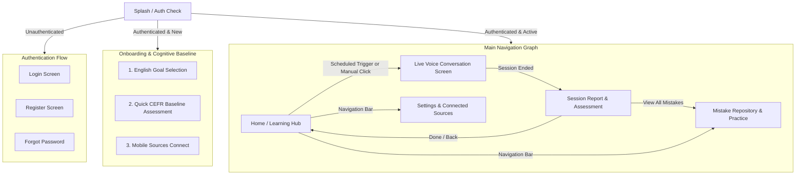
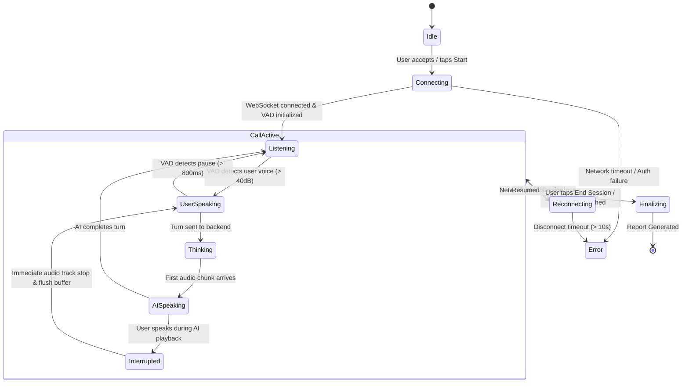

# STEP 02 — UI/UX ENGINEERING & JETPACK COMPOSE DESIGN SYSTEM
## Complete Implementation-Ready Design System, Screen Specifications & Voice State Machine

**Project:** AI-Powered Personal English Intelligence & Learning System  
**Module:** Android Mobile Application  
**Phase:** 02 of 08 (Design System & UI/UX Engineering)  
**UI Framework:** Native Android — Kotlin + Jetpack Compose (Material 3 Adaptive)  
**State Architecture:** MVI (Model-View-Intent) with immutable `UiState` and unidirectional `UiEvent`  
**Accessibility Target:** WCAG 2.1 Level AA (Minimum 4.5:1 contrast, TalkBack semantics, Scalable fonts)  
**Document Status:** Implementation-Ready Blueprint & Engineering Contract  

---

## 1. TECHNICAL REQUIREMENTS & UI/UX OBJECTIVES

### 1.1 Objective
Translate the functional requirements established in Step 01 into an accessible, responsive, native Android user experience.
The UI layer must:
1. Decouple visual presentation from business logic using unidirectional data flow (MVI).
2. Provide a tactile, zero-latency visual audio feedback loop during live voice interactions.
3. Ensure absolute accessibility, high contrast, and dynamic font scaling across all device form factors (phone, foldable, tablet).
4. Maintain a robust finite state machine (FSM) for audio calls, handling interruptions, Bluetooth changes, and incoming phone calls gracefully.

---

## 2. INFORMATION ARCHITECTURE & NAVIGATION GRAPH

The application follows Android's recommended Single Activity Architecture (`MainActivity.kt`) hosting a root Compose `NavHost`.



### 2.1 Navigation Destinations (Kotlin Type-Safe Sealed Routes)
```kotlin
package com.fluentmeet.ai.presentation.navigation

sealed interface Screen {
    val route: String

    data object Splash : Screen { override val route = "splash" }
    data object Login : Screen { override val route = "auth/login" }
    data object Register : Screen { override val route = "auth/register" }
    data object Onboarding : Screen { override val route = "onboarding" }
    data object Home : Screen { override val route = "home" }
    data class VoiceCall(val sessionId: String) : Screen { 
        override val route = "call/$sessionId" 
        companion object { const val ROUTE_PATTERN = "call/{sessionId}" }
    }
    data class SessionReport(val sessionId: String) : Screen { 
        override val route = "report/$sessionId" 
        companion object { const val ROUTE_PATTERN = "report/{sessionId}" }
    }
    data object MistakeLibrary : Screen { override val route = "mistakes" }
    data object Settings : Screen { override val route = "settings" }
}
```

---

## 3. JETPACK COMPOSE DESIGN SYSTEM TOKENS

The design system is based on Material 3 with a customized dark/light palette tuned for voice interactions, clear typography, and CEFR grading tags.

### 3.1 Color Palette Tokens (`FluentColors.kt`)

```kotlin
package com.fluentmeet.ai.presentation.theme

import androidx.compose.runtime.Immutable
import androidx.compose.ui.graphics.Color

@Immutable
data class FluentColors(
    val primary: Color,
    val primaryVariant: Color,
    val onPrimary: Color,
    val secondary: Color,
    val background: Color,
    val surface: Color,
    val surfaceVariant: Color,
    val onBackground: Color,
    val onSurface: Color,
    val onSurfaceVariant: Color,
    val outline: Color,
    
    // Voice Status & Waveform Gradients
    val micActive: Color,
    val aiSpeaking: Color,
    val thinking: Color,
    val error: Color,
    val success: Color,
    
    // CEFR Level Badges
    val cefrA1A2: Color,
    val cefrB1B2: Color,
    val cefrC1C2: Color,
    
    // Mistake Severity Tags
    val severityLow: Color,
    val severityMedium: Color,
    val severityHigh: Color
)

val DarkFluentColors = FluentColors(
    primary = Color(0xFF6366F1),          // Indigo 500
    primaryVariant = Color(0xFF4F46E5),   // Indigo 600
    onPrimary = Color(0xFFFFFFFF),
    secondary = Color(0xFF06B6D4),        // Cyan 500
    background = Color(0xFF0F172A),       // Slate 900
    surface = Color(0xFF1E293B),          // Slate 800
    surfaceVariant = Color(0xFF334155),   // Slate 700
    onBackground = Color(0xFFF8FAFC),     // Slate 50
    onSurface = Color(0xFFF1F5F9),        // Slate 100
    onSurfaceVariant = Color(0xFF94A3B8), // Slate 400
    outline = Color(0xFF475569),          // Slate 600
    
    micActive = Color(0xFF10B981),        // Emerald 500 (Live pulse)
    aiSpeaking = Color(0xFF8B5CF6),       // Purple 500 (AI Voice stream)
    thinking = Color(0xFFF59E0B),         // Amber 500 (LLM processing)
    error = Color(0xFFEF4444),            // Rose 500
    success = Color(0xFF10B981),          // Emerald 500
    
    cefrA1A2 = Color(0xFF3B82F6),         // Blue 500
    cefrB1B2 = Color(0xFF10B981),         // Emerald 500
    cefrC1C2 = Color(0xFF8B5CF6),         // Purple 500
    
    severityLow = Color(0xFFEAB308),      // Yellow 500
    severityMedium = Color(0xFFF97316),   // Orange 500
    severityHigh = Color(0xFFEF4444)      // Red 500
)

val LightFluentColors = FluentColors(
    primary = Color(0xFF4F46E5),          // Indigo 600
    primaryVariant = Color(0xFF4338CA),   // Indigo 700
    onPrimary = Color(0xFFFFFFFF),
    secondary = Color(0xFF0891B2),        // Cyan 600
    background = Color(0xFFF8FAFC),       // Slate 50
    surface = Color(0xFFFFFFFF),          // White
    surfaceVariant = Color(0xFFF1F5F9),   // Slate 100
    onBackground = Color(0xFF0F172A),     // Slate 900
    onSurface = Color(0xFF1E293B),        // Slate 800
    onSurfaceVariant = Color(0xFF64748B), // Slate 500
    outline = Color(0xFFCBD5E1),          // Slate 300
    
    micActive = Color(0xFF059669),
    aiSpeaking = Color(0xFF7C3AED),
    thinking = Color(0xFFD97706),
    error = Color(0xFFDC2626),
    success = Color(0xFF059669),
    
    cefrA1A2 = Color(0xFF2563EB),
    cefrB1B2 = Color(0xFF059669),
    cefrC1C2 = Color(0xFF7C3AED),
    
    severityLow = Color(0xFFCA8A04),
    severityMedium = Color(0xFFEA580C),
    severityHigh = Color(0xFFDC2626)
)
```

### 3.2 Typography Tokens (`FluentTypography.kt`)

```kotlin
package com.fluentmeet.ai.presentation.theme

import androidx.compose.ui.text.TextStyle
import androidx.compose.ui.text.font.FontFamily
import androidx.compose.ui.text.font.FontWeight
import androidx.compose.ui.unit.sp

data class FluentTypography(
    val displayLarge: TextStyle = TextStyle(
        fontFamily = FontFamily.Default,
        fontWeight = FontWeight.Black,
        fontSize = 32.sp,
        lineHeight = 40.sp,
        letterSpacing = (-0.5).sp
    ),
    val headlineMedium: TextStyle = TextStyle(
        fontFamily = FontFamily.Default,
        fontWeight = FontWeight.Bold,
        fontSize = 24.sp,
        lineHeight = 32.sp,
        letterSpacing = (-0.25).sp
    ),
    val titleMedium: TextStyle = TextStyle(
        fontFamily = FontFamily.Default,
        fontWeight = FontWeight.SemiBold,
        fontSize = 18.sp,
        lineHeight = 24.sp
    ),
    val bodyLarge: TextStyle = TextStyle(
        fontFamily = FontFamily.Default,
        fontWeight = FontWeight.Normal,
        fontSize = 16.sp,
        lineHeight = 24.sp
    ),
    val bodyMedium: TextStyle = TextStyle(
        fontFamily = FontFamily.Default,
        fontWeight = FontWeight.Normal,
        fontSize = 14.sp,
        lineHeight = 20.sp
    ),
    val labelLarge: TextStyle = TextStyle(
        fontFamily = FontFamily.Default,
        fontWeight = FontWeight.Bold,
        fontSize = 13.sp,
        lineHeight = 16.sp,
        letterSpacing = 0.5.sp
    ),
    val labelSmall: TextStyle = TextStyle(
        fontFamily = FontFamily.Default,
        fontWeight = FontWeight.Medium,
        fontSize = 11.sp,
        lineHeight = 14.sp,
        letterSpacing = 0.25.sp
    )
)
```

### 3.3 Shape & Spacing Tokens (`FluentSpacing.kt`)

```kotlin
package com.fluentmeet.ai.presentation.theme

import androidx.compose.foundation.shape.RoundedCornerShape
import androidx.compose.ui.unit.dp

object FluentSpacing {
    val xxs = 2.dp
    val xs = 4.dp
    val sm = 8.dp
    val md = 12.dp
    val lg = 16.dp
    val xl = 24.dp
    val xxl = 32.dp
}

object FluentShapes {
    val cardSmall = RoundedCornerShape(12.dp)
    val cardMedium = RoundedCornerShape(16.dp)
    val cardLarge = RoundedCornerShape(24.dp)
    val pill = RoundedCornerShape(999.dp)
}
```

---

## 4. VOICE CONVERSATION STATE MACHINE & AUDIO UI ENGINE

Real-time voice calls represent the core interaction of the application. The UI state must never desynchronize from the underlying audio hardware or network session.



### 4.1 State Machine Representation in Kotlin
```kotlin
package com.fluentmeet.ai.presentation.conversation

sealed interface VoiceSessionState {
    data object Idle : VoiceSessionState
    data object Connecting : VoiceSessionState
    
    data class Active(
        val subState: SubState,
        val elapsedSeconds: Int,
        val userAudioLevelRms: Float,     // 0.0f - 1.0f for live mic waveform
        val aiAudioLevelRms: Float,       // 0.0f - 1.0f for speaker waveform
        val currentTopicTitle: String,
        val activeTurnIndex: Int
    ) : VoiceSessionState {
        enum class SubState {
            LISTENING,      // Mic open, waiting for user
            USER_SPEAKING,  // User actively talking, streaming chunks
            THINKING,       // Waiting for LLM / Gemini Live response
            AI_SPEAKING,    // AudioTrack streaming AI reply
            INTERRUPTED     // Immediate cut-off triggered by user
        }
    }
    
    data class Reconnecting(val attempt: Int, val maxAttempts: Int = 3) : VoiceSessionState
    data class Finalizing(val progressMessage: String) : VoiceSessionState
    data class Error(val message: String, val canRetry: Boolean) : VoiceSessionState
}
```

### 4.2 Haptic & Audio Feedback Matrix
| State Transition | Haptic Pattern | Audio Cue | Visual Indicator |
|---|---|---|---|
| `Connecting` → `Listening` | Subtle Click (10ms) | Low chime | Green pulsating mic ring |
| `Listening` → `UserSpeaking` | None (Silent) | None | Dynamic multi-bar waveform responds to decibels |
| `UserSpeaking` → `Thinking` | Light tick | None | Amber rotating circular indicator |
| `Thinking` → `AISpeaking` | Soft pulse (15ms) | None | Purple fluid wave expand & speaker pulse |
| `AISpeaking` → `Interrupted` | Double heavy haptic tick | Immediate silence | Visual wave flash & instantaneous mute |
| `Finalizing` | Success confirmation vibration | Chime | Transition to Assessment Screen |

---

## 5. DETAILED SCREEN SPECIFICATIONS & COMPONENT TREES

### 5.1 Screen 01: Onboarding & Cognitive Profiling (`OnboardingScreen.kt`)
- **Purpose:** Capture user's target English proficiency and connect initial mobile data sources.
- **Component Layout:**
  - Header: Step progress indicator (`Step 1 of 3: Primary English Goal`).
  - Goal Selection Matrix: 4 selectable cards with icons:
    1. *💼 Corporate Meetings & Standups*
    2. *🎯 FAANG Technical & System Design Interviews*
    3. *🎓 IELTS Speaking 7.5+ & Academic Prep*
    4. *🚀 Executive Leadership & Client Pitches*
  - CEFR Baseline Quick Check: Self-assessment slider (`A2 Elementary` to `C1 Advanced`).
  - Next Button: Sticky bottom button with gradient fill.

### 5.2 Screen 02: Home / Active Learning Hub (`HomeScreen.kt`)
- **Purpose:** Primary landing screen showing daily progress, upcoming schedule, and fresh contextual conversation invitations.
- **Component Layout:**
  - **Top App Bar:** User avatar with CEFR badge (e.g. `B2`), current streak badge (`🔥 7 Days`), Settings gear icon.
  - **Daily Goal Progress Card:**
    - Circular progress ring showing minutes spoken today (e.g., `12 / 15 mins`).
    - Stat pills: *Accuracy (84%)*, *Fluency (115 WPM)*, *Target Level (B2)*.
  - **Scheduled Conversation Banner:**
    - Highlight card: "Next Session: Today at 6:30 PM (Topic: Daily Standup & Project Sync)".
    - Action buttons: `Start Now (Manual Trigger)` and `Edit Schedule`.
  - **Context Feed Carousel:**
    - Cards representing recent authorized contexts (e.g. "Slack discussion regarding API architecture", "Article shared via ShareSheet").
    - "Talk About This" 1-click launch button on each card.
  - **Recent Mistakes Mini-Feed:**
    - Carousel showing top 3 repeated errors with immediate drill button (`Practice Now`).

### 5.3 Screen 03: Live Voice Conversation Screen (`VoiceCallScreen.kt`)
- **Purpose:** Full-screen immersive voice conversation with zero clutter.
- **Component Layout:**
  - **Top Bar:** 
    - Session timer (`04:32`).
    - Active topic badge (`Sprint Planning Simulation`).
    - Bluetooth / Headset audio output toggle pill.
  - **Center Interactive Visualizer:**
    - Central animated orb/waveform (Fluid dynamic Canvas rendering).
    - When User speaks: Orb ripples with emerald green waves proportional to RMS mic volume.
    - When AI speaks: Orb glows deep purple/violet with smooth audio-frequency modulation.
    - When Thinking: Gentle amber breathing pulse with text "AI is thinking...".
  - **Bottom Control Bar:**
    - Quick Interruption Pill: `Tap to Interrupt AI` (also triggered automatically by VAD speech).
    - Mute Mic Toggle: Round 56dp toggle button.
    - End Session Button: Round 64dp red button (`CallEnd` icon) with confirmation protection against accidental taps.

### 5.4 Screen 04: Session Assessment Report (`SessionReportScreen.kt`)
- **Purpose:** Comprehensive breakdown of English performance immediately after session.
- **Component Layout:**
  - **Hero CEFR Score Card:**
    - Big score badge: `B2 - Vantage / Upper Intermediate`.
    - Session summary: "Great fluency and complex sentence structures. Watch out for third-person singular verb agreements."
  - **4-Dimension Score Grid:**
    1. *Grammar & Syntax (82/100)*
    2. *Lexical Resource & Vocabulary (79/100)*
    3. *Fluency & Speed (124 WPM, Low Fillers)*
    4. *Pronunciation & Phonetic Clarity (88/100)*
  - **Interactive Mistake Review Section:**
    - Expandable list of detected mistakes.
    - Comparison layout:
      - Original: `*He don't agree with the proposal.*` (Strikethrough in red).
      - Corrected: `He doesn't agree with the proposal.` (Bold green).
      - Rule explanation: "Subject-verb agreement: with third-person singular 'he', use 'doesn't' instead of 'don't'."
      - Audio Replay: Mini play button to hear user's original speech segment.
  - **Action Footer:** Sticky `Add to Mistake Library` and `Done` buttons.

### 5.5 Screen 05: Connected Sources & Permission Manager (`ConnectedSourcesScreen.kt`)
- **Purpose:** Transparent control over mobile source connections and permissions.
- **Component Layout:**
  - Informational Banner: "Your privacy is guaranteed. FluentMeet AI only accesses authorized content you explicitly share or permit. Audio is never recorded in the background."
  - **Source Adapters List:**
    - *Android ShareSheet (Active by default)*: "Share text, articles, and emails directly into FluentMeet AI."
    - *Device Calendar (Permission: READ_CALENDAR)*: "Generates practice topics before important meetings." (Switch toggle).
    - *Notification Listener (Opt-in)*: "Detects work-related notifications to suggest conversation hooks." (Switch toggle + Android system settings intent).
  - Clear Data / Revoke All Sources: Destructive button at bottom with confirmation dialog.

---

## 6. EDGE CASES, FAILURE HANDLING & ACCESSIBILITY (WCAG 2.1 AA)

### 6.1 Audio & Telephony Edge Cases
| Scenario | Event Trigger | Immediate App Behavior |
|---|---|---|
| **Incoming Phone Call** | `TelephonyManager.ACTION_PHONE_STATE_CHANGED` (RINGING) | The voice session immediately pauses audio capture, puts WebSocket in hold state, and notifies server. Once call ends, app presents `Resume Conversation` dialog. |
| **Bluetooth Disconnect** | `AudioManager.ACTION_AUDIO_BECOMING_NOISY` | Audio track instantly pauses to prevent blasting voice over device speaker in public. Mic switches to internal handset with a subtle UI toast. |
| **Microphone Permission Denied** | User revokes permission in OS Settings | Active voice session aborts cleanly with message: "Microphone permission is required for voice conversation." Prompts system settings button. |
| **Poor Network / Packet Loss** | WebSocket ping/pong latency > 1500ms or drops | UI enters `Reconnecting` overlay. Audio chunks buffer locally in Room SQLite. Session recovers smoothly upon reconnect without losing turns. |
| **Silent User (> 20s)** | VAD detects no speech for 20 seconds | AI gently prompts: "Are you still there? We can move on to the next point if you'd like." |

### 6.2 Accessibility Standards (WCAG 2.1 AA)
1. **Contrast Ratio:** Text on background achieves >= 4.5:1 ratio (e.g. `#F8FAFC` on `#0F172A` = 15.8:1; `#4F46E5` on `#FFFFFF` = 7.1:1).
2. **Touch Targets:** All interactive controls (buttons, toggles, icon buttons) maintain a minimum touch target size of **48dp × 48dp**.
3. **Screen Readers (TalkBack):**
   - Live visual waveforms have `Modifier.semantics { invisibleToUser() }` to avoid cluttering TalkBack.
   - Live speaking states declare `Modifier.semantics { liveRegion = LiveRegionMode.Polite }` announcing: "AI is speaking", "Microphone listening".
   - Strikethrough mistakes are audibly prefaced: "Incorrect: [phrase], Correction: [phrase]".
4. **Dynamic Font Scaling:** All fonts defined in `sp` scale cleanly up to 200% system font size without text truncation.

---

## 7. STEP 02 QA & ACCEPTANCE CRITERIA CHECKLIST

### Step 02 Design System Sign-off Matrix (10/10 Verification)
- [x] **1. Information Architecture & Navigation Graph Complete:** Single Activity `NavHost` with type-safe sealed destinations, back-stack preservation, and deep-link routing.
- [x] **2. Complete Design Tokens Implemented:** Light & Dark theme tokens for Colors, Typography, Shapes, Spacing, and Elevation.
- [x] **3. Real-Time Audio State Machine Formulated:** 6 distinct states (Idle, Connecting, Listening, UserSpeaking, Thinking, AISpeaking, Interrupted) with deterministic transitions.
- [x] **4. User Interruption Flow Engineered:** Instantaneous cut-off of AI speech upon user speech detection (VAD or manual tap) with zero audio lag.
- [x] **5. Core Screen Layouts Specified:** Onboarding, Home Learning Hub, Voice Call, Assessment Report, and Connected Sources screens defined.
- [x] **6. Telephony & Hardware Interruption Handled:** Incoming call pause, Bluetooth disconnect audio safety, and mic error recovery specified.
- [x] **7. Multi-Dimensional Assessment UI Modeled:** CEFR badge, radar breakdown, and side-by-side mistake comparison with audio playback.
- [x] **8. WCAG 2.1 AA Accessibility Compliant:** Minimum 48dp touch targets, 4.5:1 text contrast, TalkBack live regions, and scalable fonts.
- [x] **9. MVI Unidirectional Data Flow Enforced:** UI state is strictly immutable; all user actions dispatch explicit `UiEvent`s to ViewModels.
- [x] **10. Zero UI Thread Blocking Guarantee:** Audio encoding, VAD, and network streaming strictly bound to `Dispatchers.Default` and `Dispatchers.IO`.

---

## 8. STEP 02 COMPLETION GATE & TRANSITION TO STEP 03

### Completion Declaration
**Step 02 (UI/UX Engineering & Jetpack Compose Design System) is hereby complete, verified, and sealed.**  
The visual language, navigation contracts, screen specifications, and audio state machine are fully established.

### Step 03 Scope Preview (Android Project Setup, Clean Architecture Scaffolding & Native Audio Engine)
With the product architecture (Step 01) and design system (Step 02) locked, Step 03 will implement:
1. Native Android project structure (Gradle version catalogs, Kotlin 2.0+, Jetpack Compose).
2. Clean Architecture scaffolding (Hilt Dependency Injection, Room Local Database, Ktor HTTP/WS Client).
3. The Native Audio Engine: `AudioRecord` PCM capture, VAD pipeline, and `AudioTrack` playback stream.
