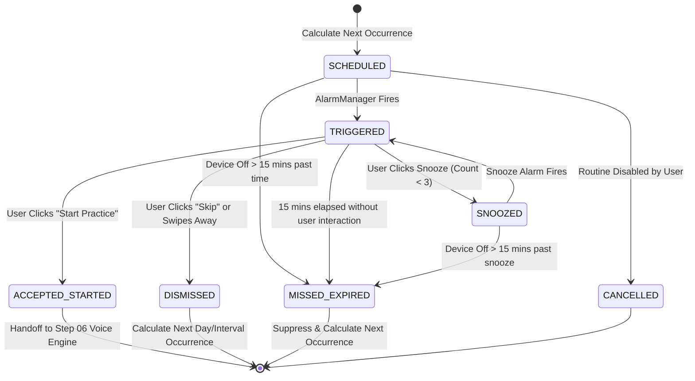

# STEP 05 — SMART SCHEDULER & PROACTIVE NOTIFICATION ENGINE

## Implementation-Ready System Engineering Specification

**Product:** AI-Powered Personal English Intelligence & Learning System  
**Development Stage:** Stage 01 — Mobile Application  
**Step:** 05 of 15  
**Previous Step:** [Step 04 — Mobile Context Collection Engine](../step-04-context-collection/STEP_04_MOBILE_CONTEXT_COLLECTION_ENGINE.md)  
**Next Step:** Step 06 — Real-time AI Voice Conversation Engine  
**Platform:** Native Android  
**Primary Language:** Kotlin (1.9.23+)  
**UI Framework:** Jetpack Compose (BOM 2024.04.01+)  
**Architecture:** Clean Architecture + MVI/MVVM + Repository Pattern  
**Scheduling Primitives:** `AlarmManager` (`setExactAndAllowWhileIdle`) + `WorkManager` (Reconciliation & Inexact Fallback)  
**Local Database:** Room 2.6.1+ / SQLite (Cipher-ready)  
**Backend:** Python 3.11+ / FastAPI  
**Target Android Version:** API 34 (Android 14)  
**Min Android Version:** API 26 (Android 8.0 Oreo)  

---

## 1. STEP 05 — OBJECTIVE & ARCHITECTURAL SCOPE

### 1.1 Mission Statement
Step 05 establishes the proactive intelligence layer of FluentMeet-AI. It transforms English practice from an ad-hoc, easily-forgotten chore into an automated, habit-forming daily routine. The engine tracks user learning habits, honors strict quiet hours and work calendars, computes future practice opportunities, schedules precision reminders across OS restarts, and presents context-rich notification invitations that can transition directly into interactive spoken AI sessions.

### 1.2 Core Architectural Scope
```
[ User Routine Preferences ]
           │
           ▼
[ Smart Schedule Engine ] ──(Calculates)──► [ Next Occurrences (Room DB) ]
           │                                            │
           ├────────────────────────┬───────────────────┤
           ▼                        ▼                   ▼
[ Exact Alarm Scheduler ]  [ Inexact WorkManager ]  [ Reconciliation Worker ]
(AlarmManager API 31+)      (Battery-Saver / Fallback)   (Boot / Timezone Change)
           │                        │                   │
           └────────────────────────┼───────────────────┘
                                    │
                                    ▼
                         [ BroadcastReceiver ]
                                    │
                                    ▼
                     [ Proactive Notification Engine ]
                      - Post-Notification Permission (API 33+)
                      - Dedicated High-Priority Channel
                      - Context Hook (from Step 04)
                      - Interactive Actions: [Start Practice] [Snooze] [Skip]
                                    │
                     User Taps "Start Practice"
                                    │
                                    ▼
             [ Step 06: Voice Conversation Engine Handoff ]
               (Explicit User Intent - NEVER Silent Mic)
```

---

## 2. 10 NON-NEGOTIABLE ARCHITECTURAL RULES

| Rule ID | Rule Name | Description & Technical Enforcement |
|:---|:---|:---|
| **RULE-01** | **Database as Single Source of Truth** | OS Alarms (`AlarmManager`) and jobs (`WorkManager`) are stateless wake-up triggers. All schedule rules, generated occurrences, delivery states, and history reside strictly in Room SQLite. |
| **RULE-02** | **Zero Silent Microphone Activation** | The Scheduler and Notification components **MUST NEVER** activate the microphone, acquire `RECORD_AUDIO`, or boot the WebRTC/Gemini audio pipeline in the background. Audio capture is strictly gated behind an explicit user tap on the UI (Step 06 handoff). |
| **RULE-03** | **Occurrence Deduplication Guarantee** | Reminders are keyed by a UUID `occurrence_id` and unique integer `alarm_request_code`. The engine will never display more than one notification for the same practice window. |
| **RULE-04** | **Reboot & Time Boundary Survival** | All scheduled reminders persist across device reboots, app updates, manual time changes, and timezone shifts via `BootReceiver`, `TimeChangeReceiver`, and an idempotent DB reconciliation pass. |
| **RULE-05** | **Timezone-Aware & DST Integrity** | Recurring schedules store local civil time (`LocalTime` e.g., `19:30`) + IANA Timezone ID (e.g., `Asia/Dhaka`). Generated occurrences resolve to absolute UTC epoch milliseconds (`scheduled_epoch_ms`), handling Daylight Saving shifts without duplicate or missed alerts. |
| **RULE-06** | **Tiered Background Execution Strategy** | Strict capability detection: If `AlarmManager.canScheduleExactAlarms()` is true, use `setExactAndAllowWhileIdle()`. If denied or revoked by OEM power saving, gracefully fall back to inexact `WorkManager` periodic tasks without crashing. |
| **RULE-07** | **Modular Quiet Hours & Active Window** | Practice invitations are strictly confined to user-defined Active Hours. Cross-midnight Quiet Hours (e.g., 22:00 to 07:00) must be handled using modular circular arithmetic. Reminders falling into quiet zones are automatically clamped or rescheduled. |
| **RULE-08** | **Stale Reminder Expiration (Anti-Spam)** | An occurrence has a strict **15-minute validity window**. If the device was powered off or throttled during the trigger time and wakes up after `scheduled_epoch_ms + 15 mins`, the reminder is flagged `MISSED_EXPIRED` and silently suppressed. |
| **RULE-09** | **Idempotent Notification Action Handlers** | Notification button interactions (`START`, `SNOOZE`, `DISMISS`) use `PendingIntent.FLAG_IMMUTABLE | PendingIntent.FLAG_UPDATE_CURRENT`. Multiple rapid clicks are deduplicated via atomic Room status transitions. |
| **RULE-10** | **Decoupled Context-Enriched Handoff** | If Step 04 contains recently collected user context (e.g., "Read article on AI Architecture 2 hours ago"), the notification dynamically integrates this topic into its title/body. Acceptance packages the context into a parcelable `SessionInvitation` delivered to Step 06. |

---

## 3. ANDROID BACKGROUND EXECUTION & CAPABILITY MATRIX

### 3.1 Technology Evaluation & Selection

```
┌─────────────────────────────────┬──────────────────────────┬─────────────────────────────┬──────────────────────────┐
│ Mechanism                       │ Precision                │ Doze Mode Behavior          │ Use Case in FluentMeet   │
├─────────────────────────────────┼──────────────────────────┼─────────────────────────────┼──────────────────────────┤
│ AlarmManager                    │ Sub-second to exact      │ Fires in Doze via           │ PRIMARY: Precision       │
│ .setExactAndAllowWhileIdle()     │ minute                   │ AllowWhileIdle quota        │ Practice Reminders       │
├─────────────────────────────────┼──────────────────────────┼─────────────────────────────┼──────────────────────────┤
│ WorkManager                     │ 15-minute minimum batch  │ Deferred until maintenance  │ SECONDARY: Reconciliation,│
│ (PeriodicWorkRequest)           │ inexact window           │ window                      │ DB cleanup, sync fallback│
├─────────────────────────────────┼──────────────────────────┼─────────────────────────────┼──────────────────────────┤
│ Foreground Service              │ Continuous CPU execution │ Immune to Doze              │ FORBIDDEN for scheduler; │
│                                 │                          │ (High battery drain)        │ Reserved for Step 06 call│
├─────────────────────────────────┼──────────────────────────┼─────────────────────────────┼──────────────────────────┤
│ Inexact AlarmManager            │ Batched by OS (±30 mins) │ Deferred to batch wake-up   │ FALLBACK: When exact     │
│ .set()                          │                          │                             │ alarm permission denied  │
└─────────────────────────────────┴──────────────────────────┴─────────────────────────────┴──────────────────────────┘
```

### 3.2 Exact Alarm Permission Handling (Android 12+ API 31 & Android 14+ API 34)
Android 12 introduced `SCHEDULE_EXACT_ALARM` and Android 13/14 introduced `USE_EXACT_ALARM`. For productivity and habit-building educational applications:
- The app declares `<uses-permission android:name="android.permission.SCHEDULE_EXACT_ALARM" />`.
- At runtime, the `SchedulerCapabilityDetector` evaluates:
```kotlin
fun canScheduleExactAlarms(context: Context): Boolean {
    val alarmManager = context.getSystemService(Context.ALARM_SERVICE) as AlarmManager
    return if (Build.VERSION.SDK_INT >= Build.VERSION_CODES.S) {
        alarmManager.canScheduleExactAlarms()
    } else {
        true
    }
}
```
- If false, the UI prompts the user via `Settings.ACTION_REQUEST_SCHEDULE_EXACT_ALARM`.
- If permission is denied or revoked, the engine dynamically activates `InexactWorkManagerFallbackScheduler`.

---

## 4. ROUTINE & TIMING CALCULATION ALGORITHMS

### 4.1 Schedule Types
1. **Interval-Based:** Remind every `N` hours (e.g., every 2 hours) exclusively within Active Hours.
2. **Fixed Daily Times:** Specific user-chosen times (e.g., `08:30 AM`, `01:15 PM`, `08:00 PM`).
3. **Weekly Habit Anchors:** Specific days of the week (e.g., Monday, Wednesday, Friday) with day-specific time slots.

### 4.2 Cross-Midnight Quiet Hours Calculation (Circular Clock Arithmetic)
To safely evaluate whether time $T$ falls inside Quiet Hours $[S, E]$ when $S > E$ (e.g., 22:00 to 07:00):

$$\text{isQuietTime}(T, S, E) = \begin{cases} 
T \ge S \lor T < E & \text{if } S > E \text{ (Cross-Midnight)} \\
T \ge S \land T < E & \text{if } S < E \text{ (Same Day)} \\
\text{false} & \text{if } S = E \text{ (Disabled)}
\end{cases}$$

```kotlin
fun isInsideQuietHours(
    targetTime: LocalTime,
    quietStart: LocalTime,
    quietEnd: LocalTime
): Boolean {
    if (quietStart == quietEnd) return false // No quiet hours configured
    return if (quietStart.isAfter(quietEnd)) {
        // Crosses midnight: e.g., 22:00 -> 07:00
        targetTime >= quietStart || targetTime < quietEnd
    } else {
        // Same day window: e.g., 13:00 -> 15:00
        targetTime >= quietStart && targetTime < quietEnd
    }
}
```

### 4.3 Next Occurrence Resolution Algorithm (DST & Zone Aware)
```kotlin
fun calculateNextOccurrence(
    rule: ScheduleRule,
    fromInstant: Instant,
    userZoneId: ZoneId
): ZonedDateTime? {
    var candidate = fromInstant.atZone(userZoneId)
    val quietStart = rule.quietHoursStart
    val quietEnd = rule.quietHoursEnd

    when (rule.type) {
        ScheduleType.FIXED_TIME -> {
            for (timeSlot in rule.fixedTimes.sorted()) {
                val candidateTime = candidate.toLocalDate().atTime(timeSlot).atZone(userZoneId)
                if (candidateTime.toInstant().isAfter(fromInstant) && 
                    !isInsideQuietHours(timeSlot, quietStart, quietEnd)) {
                    return candidateTime
                }
            }
            // If none left today, roll to tomorrow's first non-quiet slot
            val tomorrow = candidate.toLocalDate().plusDays(1)
            for (timeSlot in rule.fixedTimes.sorted()) {
                if (!isInsideQuietHours(timeSlot, quietStart, quietEnd)) {
                    return tomorrow.atTime(timeSlot).atZone(userZoneId)
                }
            }
        }
        ScheduleType.INTERVAL -> {
            val intervalMinutes = rule.intervalMinutes
            var nextTime = candidate.plusMinutes(intervalMinutes.toLong())
            
            // If nextTime falls into quiet hours, advance to quietEnd
            if (isInsideQuietHours(nextTime.toLocalTime(), quietStart, quietEnd)) {
                nextTime = if (quietStart.isAfter(quietEnd)) {
                    if (nextTime.toLocalTime() >= quietStart) {
                        nextTime.toLocalDate().plusDays(1).atTime(quietEnd).atZone(userZoneId)
                    } else {
                        nextTime.toLocalDate().atTime(quietEnd).atZone(userZoneId)
                    }
                } else {
                    nextTime.toLocalDate().atTime(quietEnd).atZone(userZoneId)
                }
            }
            return nextTime
        }
        ScheduleType.WEEKLY -> {
            // Evaluates active days (Bitmask or Set of DayOfWeek)
            // Searches forward up to 8 days to find the next valid occurrence
            for (offset in 0..7) {
                val testDate = candidate.toLocalDate().plusDays(offset.toLong())
                if (rule.activeDays.contains(testDate.dayOfWeek)) {
                    for (timeSlot in rule.fixedTimes.sorted()) {
                        val testDateTime = testDate.atTime(timeSlot).atZone(userZoneId)
                        if (testDateTime.toInstant().isAfter(fromInstant) &&
                            !isInsideQuietHours(timeSlot, quietStart, quietEnd)) {
                            return testDateTime
                        }
                    }
                }
            }
        }
    }
    return null
}
```

---

## 5. ROOM DATABASE SCHEMA & DATA MODEL

### 5.1 Entity Relationship Diagram (ERD)

```
┌─────────────────────────┐           1:N          ┌─────────────────────────┐
│       schedules         │───────────────────────►│      schedule_days      │
│ ─────────────────────── │                        │ ─────────────────────── │
│ PK id: TEXT (UUID)      │                        │ PK schedule_id + day_idx│
│ name: TEXT              │                        └─────────────────────────┘
│ type: TEXT (Enum)       │           1:N          ┌─────────────────────────┐
│ is_active: INTEGER      │───────────────────────►│     schedule_times      │
│ timezone_id: TEXT       │                        │ ─────────────────────── │
│ quiet_start: TEXT       │                        │ PK schedule_id + time   │
│ quiet_end: TEXT         │                        └─────────────────────────┘
│ interval_mins: INTEGER  │           1:N          ┌─────────────────────────┐
│ max_snooze_count: INT   │───────────────────────►│  schedule_occurrences   │
│ created_at: INTEGER     │                        │ ─────────────────────── │
└─────────────────────────┘                        │ PK id: TEXT (UUID)      │
                                                   │ FK schedule_id: TEXT    │
                                                   │ scheduled_epoch_ms: INT │
                                                   │ status: TEXT (Enum)     │
                                                   │ alarm_request_code: INT │
                                                   │ snooze_count: INTEGER   │
                                                   │ context_hook_id: TEXT   │
                                                   └────────────┬────────────┘
                                                                │ 1:N
                                                                ▼
                                                   ┌─────────────────────────┐
                                                   │     reminder_events     │
                                                   │ ─────────────────────── │
                                                   │ PK id: TEXT (UUID)      │
                                                   │ FK occurrence_id: TEXT  │
                                                   │ event_type: TEXT        │
                                                   │ timestamp_ms: INTEGER   │
                                                   │ metadata_json: TEXT     │
                                                   └─────────────────────────┘
```

### 5.2 Room DDL & Entities

```kotlin
package com.fluentmeet.core.database.entity

import androidx.room.*

enum class ScheduleType { INTERVAL, FIXED_TIME, WEEKLY }
enum class OccurrenceStatus {
    SCHEDULED,
    TRIGGERED,
    SNOOZED,
    DISMISSED,
    ACCEPTED_STARTED,
    MISSED_EXPIRED,
    CANCELLED
}
enum class ReminderEventType {
    ALARM_FIRED,
    NOTIFICATION_SHOWN,
    SNOOZE_CLICKED,
    SKIP_CLICKED,
    ACCEPT_CLICKED,
    EXPIRED_SUPPRESSED
}

@Entity(tableName = "schedules")
data class ScheduleEntity(
    @PrimaryKey val id: String, // UUID
    @ColumnInfo(name = "name") val name: String,
    @ColumnInfo(name = "type") val type: ScheduleType,
    @ColumnInfo(name = "is_active") val isActive: Boolean,
    @ColumnInfo(name = "timezone_id") val timezoneId: String, // e.g. "Asia/Dhaka"
    @ColumnInfo(name = "quiet_hours_start") val quietHoursStart: String, // "22:00"
    @ColumnInfo(name = "quiet_hours_end") val quietHoursEnd: String,     // "07:00"
    @ColumnInfo(name = "interval_minutes") val intervalMinutes: Int?,    // For INTERVAL type
    @ColumnInfo(name = "max_snooze_count") val maxSnoozeCount: Int = 3,
    @ColumnInfo(name = "created_at_ms") val createdAtMs: Long,
    @ColumnInfo(name = "updated_at_ms") val updatedAtMs: Long
)

@Entity(
    tableName = "schedule_days",
    primaryKeys = ["schedule_id", "day_of_week"],
    foreignKeys = [
        ForeignKey(
            entity = ScheduleEntity::class,
            parentColumns = ["id"],
            childColumns = ["schedule_id"],
            onDelete = ForeignKey.CASCADE
        )
    ],
    indices = [Index("schedule_id")]
)
data class ScheduleDayEntity(
    @ColumnInfo(name = "schedule_id") val scheduleId: String,
    @ColumnInfo(name = "day_of_week") val dayOfWeek: Int // 1 (Mon) to 7 (Sun)
)

@Entity(
    tableName = "schedule_times",
    primaryKeys = ["schedule_id", "time_slot"],
    foreignKeys = [
        ForeignKey(
            entity = ScheduleEntity::class,
            parentColumns = ["id"],
            childColumns = ["schedule_id"],
            onDelete = ForeignKey.CASCADE
        )
    ],
    indices = [Index("schedule_id")]
)
data class ScheduleTimeEntity(
    @ColumnInfo(name = "schedule_id") val scheduleId: String,
    @ColumnInfo(name = "time_slot") val timeSlot: String // "08:30"
)

@Entity(
    tableName = "schedule_occurrences",
    foreignKeys = [
        ForeignKey(
            entity = ScheduleEntity::class,
            parentColumns = ["id"],
            childColumns = ["schedule_id"],
            onDelete = ForeignKey.CASCADE
        )
    ],
    indices = [
        Index("schedule_id"),
        Index("scheduled_epoch_ms"),
        Index("status")
    ]
)
data class ScheduleOccurrenceEntity(
    @PrimaryKey val id: String, // UUID
    @ColumnInfo(name = "schedule_id") val scheduleId: String,
    @ColumnInfo(name = "scheduled_epoch_ms") val scheduledEpochMs: Long,
    @ColumnInfo(name = "status") val status: OccurrenceStatus,
    @ColumnInfo(name = "alarm_request_code") val alarmRequestCode: Int,
    @ColumnInfo(name = "snooze_count") val snoozeCount: Int = 0,
    @ColumnInfo(name = "original_scheduled_epoch_ms") val originalScheduledEpochMs: Long,
    @ColumnInfo(name = "context_hook_id") val contextHookId: String? = null,
    @ColumnInfo(name = "last_updated_epoch_ms") val lastUpdatedEpochMs: Long
)

@Entity(
    tableName = "reminder_events",
    foreignKeys = [
        ForeignKey(
            entity = ScheduleOccurrenceEntity::class,
            parentColumns = ["id"],
            childColumns = ["occurrence_id"],
            onDelete = ForeignKey.CASCADE
        )
    ],
    indices = [Index("occurrence_id"), Index("timestamp_ms")]
)
data class ReminderEventEntity(
    @PrimaryKey val id: String,
    @ColumnInfo(name = "occurrence_id") val occurrenceId: String,
    @ColumnInfo(name = "event_type") val eventType: ReminderEventType,
    @ColumnInfo(name = "timestamp_ms") val timestampMs: Long,
    @ColumnInfo(name = "metadata_json") val metadataJson: String? = null
)
```

### 5.3 Room Data Access Objects (DAOs)

```kotlin
package com.fluentmeet.core.database.dao

import androidx.room.*
import com.fluentmeet.core.database.entity.*
import kotlinx.coroutines.flow.Flow

@Dao
interface SchedulerDao {
    @Transaction
    @Query("SELECT * FROM schedules WHERE is_active = 1")
    fun observeActiveSchedules(): Flow<List<ScheduleEntity>>

    @Query("SELECT * FROM schedules WHERE id = :scheduleId")
    suspend fun getScheduleById(scheduleId: String): ScheduleEntity?

    @Insert(onConflict = OnConflictStrategy.REPLACE)
    suspend fun insertSchedule(schedule: ScheduleEntity)

    @Insert(onConflict = OnConflictStrategy.REPLACE)
    suspend fun insertDays(days: List<ScheduleDayEntity>)

    @Insert(onConflict = OnConflictStrategy.REPLACE)
    suspend fun insertTimes(times: List<ScheduleTimeEntity>)

    @Insert(onConflict = OnConflictStrategy.REPLACE)
    suspend fun insertOccurrence(occurrence: ScheduleOccurrenceEntity)

    @Update
    suspend fun updateOccurrence(occurrence: ScheduleOccurrenceEntity)

    @Query("SELECT * FROM schedule_occurrences WHERE id = :occurrenceId")
    suspend fun getOccurrenceById(occurrenceId: String): ScheduleOccurrenceEntity?

    @Query("""
        SELECT * FROM schedule_occurrences 
        WHERE status = 'SCHEDULED' 
        ORDER BY scheduled_epoch_ms ASC 
        LIMIT 1
    """)
    suspend fun getNextScheduledOccurrence(): ScheduleOccurrenceEntity?

    @Query("""
        SELECT * FROM schedule_occurrences 
        WHERE status = 'SCHEDULED' AND scheduled_epoch_ms < :cutoffEpochMs
    """)
    suspend fun getExpiredScheduledOccurrences(cutoffEpochMs: Long): List<ScheduleOccurrenceEntity>

    @Insert(onConflict = OnConflictStrategy.REPLACE)
    suspend fun insertEvent(event: ReminderEventEntity)

    @Transaction
    suspend fun markOccurrenceSnoozed(
        occurrenceId: String,
        newScheduledEpochMs: Long,
        newSnoozeCount: Int,
        newRequestCode: Int,
        nowMs: Long
    ) {
        val current = getOccurrenceById(occurrenceId) ?: return
        updateOccurrence(
            current.copy(
                status = OccurrenceStatus.SNOOZED,
                scheduledEpochMs = newScheduledEpochMs,
                snoozeCount = newSnoozeCount,
                alarmRequestCode = newRequestCode,
                lastUpdatedEpochMs = nowMs
            )
        )
        insertEvent(
            ReminderEventEntity(
                id = java.util.UUID.randomUUID().toString(),
                occurrenceId = occurrenceId,
                eventType = ReminderEventType.SNOOZE_CLICKED,
                timestamp_ms = nowMs,
                metadataJson = """{"snooze_count": $newSnoozeCount, "new_epoch": $newScheduledEpochMs}"""
            )
        )
    }
}
```

---

## 6. NOTIFICATION ENGINE & CHANNELS ARCHITECTURE

### 6.1 Android 13+ (API 33) Runtime Permission Flow
- Android 13 introduces `android.permission.POST_NOTIFICATIONS`.
- If permission is denied, the Scheduler records occurrences in the database but suppresses `NotificationManager.notify()`. The app displays an in-app indicator notifying the user that reminders are muted due to system settings.

### 6.2 Notification Channel Hierarchy
```kotlin
object NotificationChannels {
    const val CHANNEL_PRACTICE_REMINDER = "channel_practice_reminder_v1"
    const val CHANNEL_SCHEDULE_RECONCILIATION = "channel_scheduler_silent_v1"

    fun createChannels(context: Context) {
        if (Build.VERSION.SDK_INT >= Build.VERSION_CODES.O) {
            val notificationManager = context.getSystemService(Context.NOTIFICATION_SERVICE) as NotificationManager
            
            // 1. Interactive High-Importance Channel for Practice Invitations
            val reminderChannel = NotificationChannel(
                CHANNEL_PRACTICE_REMINDER,
                "English Practice Reminders",
                NotificationManager.IMPORTANCE_HIGH
            ).apply {
                description = "Proactive daily reminders to start conversational English practice."
                enableLights(true)
                lightColor = Color.BLUE
                enableVibration(true)
                vibrationPattern = longArrayOf(0, 250, 150, 250)
                lockscreenVisibility = Notification.VISIBILITY_PUBLIC
                setShowBadge(true)
            }
            
            // 2. Silent Low-Importance Channel for Background Diagnostics
            val silentChannel = NotificationChannel(
                CHANNEL_SCHEDULE_RECONCILIATION,
                "Scheduler System Status",
                NotificationManager.IMPORTANCE_MIN
            ).apply {
                description = "Internal maintenance notifications"
                setShowBadge(false)
            }

            notificationManager.createNotificationChannels(listOf(reminderChannel, silentChannel))
        }
    }
}
```

### 6.3 Notification Payload, PendingIntents & Action Buttons

```
┌─────────────────────────────────────────────────────────────┐
│ 🔔 FluentMeet-AI • 2m ago                                  │
│ Time for your 5-min Spoken Practice!                       │
│ "Let's review the cloud architecture topic you read today"  │
│                                                             │
│ [ 🎙️ Start Practice ]    [ ⏱️ Snooze 10m ]    [ ✕ Skip ]   │
└─────────────────────────────────────────────────────────────┘
```

1. **`Start Practice` Action:**
   - Intent targeted to `PracticeInvitationActivity` (or main deep link).
   - Flag: `FLAG_IMMUTABLE | FLAG_UPDATE_CURRENT`.
   - Extra: `EXTRA_OCCURRENCE_ID`, `EXTRA_CONTEXT_HOOK_ID`.
   - On launch, dismisses notification and triggers Room status `ACCEPTED_STARTED`.
2. **`Snooze` Action:**
   - BroadcastIntent targeted to `ReminderActionReceiver`.
   - Extra: `ACTION_SNOOZE`, `EXTRA_OCCURRENCE_ID`, `EXTRA_SNOOZE_DURATION_MINUTES = 10`.
   - Reschedules alarm via `AlarmManager` for `now + 10 mins`.
3. **`Skip / Dismiss` Action:**
   - BroadcastIntent targeted to `ReminderActionReceiver`.
   - Extra: `ACTION_SKIP`, `EXTRA_OCCURRENCE_ID`.
   - Cancels notification, updates occurrence status to `DISMISSED`.

---

## 7. LIFECYCLE, RECONCILIATION & REBOOT SURVIVAL

### 7.1 Broadcast Receivers Architecture
Android OS clears all pending `AlarmManager` alarms upon device shutdown or reboot. To ensure zero dropped schedules, FluentMeet-AI employs a 3-way reconciliation architecture:

```
[ Device Reboot (ACTION_BOOT_COMPLETED) ] ───────┐
[ Timezone Changed (ACTION_TIMEZONE_CHANGED) ] ───┼──► [ SchedulerReconciliationReceiver ]
[ Manual Clock Shift (ACTION_TIME_CHANGED) ] ────┤                  │
[ App Cold Start / OnResume ] ───────────────────┘                  ▼
                                                    [ SchedulerReconciliationWorker ]
                                                    (Enqueued via WorkManager)
                                                                    │
                                            ┌───────────────────────┴───────────────────────┐
                                            ▼                                               ▼
                             [ Purge / Expire Past Alarms ]                 [ Reschedule Valid Future Alarms ]
                             (Scheduled < Now - 15 mins                     (AlarmManager.setExactAndAllowWhileIdle)
                              marked MISSED_EXPIRED)
```

### 7.2 Manifest Configuration
```xml
<receiver
    android:name="com.fluentmeet.feature.scheduler.receiver.AlarmTriggerReceiver"
    android:exported="false">
    <intent-filter>
        <action android:name="com.fluentmeet.action.TRIGGER_REMINDER" />
    </intent-filter>
</receiver>

<receiver
    android:name="com.fluentmeet.feature.scheduler.receiver.ReminderActionReceiver"
    android:exported="false">
    <intent-filter>
        <action android:name="com.fluentmeet.action.ACTION_SNOOZE" />
        <action android:name="com.fluentmeet.action.ACTION_SKIP" />
    </intent-filter>
</receiver>

<receiver
    android:name="com.fluentmeet.feature.scheduler.receiver.SchedulerReconciliationReceiver"
    android:exported="true"
    android:enabled="true">
    <intent-filter>
        <action android:name="android.intent.action.BOOT_COMPLETED" />
        <action android:name="android.intent.action.TIME_SET" />
        <action android:name="android.intent.action.TIMEZONE_CHANGED" />
        <action android:name="android.intent.action.MY_PACKAGE_REPLACED" />
    </intent-filter>
</receiver>
```

### 7.3 Reconciliation Worker Implementation
```kotlin
package com.fluentmeet.feature.scheduler.worker

import android.content.Context
import androidx.work.CoroutineWorker
import androidx.work.WorkerParameters
import com.fluentmeet.core.database.dao.SchedulerDao
import com.fluentmeet.core.database.entity.OccurrenceStatus
import com.fluentmeet.feature.scheduler.alarm.AlarmScheduler
import java.time.Instant

class SchedulerReconciliationWorker(
    appContext: Context,
    params: WorkerParameters,
    private val schedulerDao: SchedulerDao,
    private val alarmScheduler: AlarmScheduler
) : CoroutineWorker(appContext, params) {

    override suspend fun doWork(): Result {
        val nowMs = System.currentTimeMillis()
        val expirationCutoffMs = nowMs - (15 * 60 * 1000L) // 15 mins window

        // 1. Clean up stale missed occurrences
        val expired = schedulerDao.getExpiredScheduledOccurrences(expirationCutoffMs)
        expired.forEach { occurrence ->
            schedulerDao.updateOccurrence(
                occurrence.copy(
                    status = OccurrenceStatus.MISSED_EXPIRED,
                    lastUpdatedEpochMs = nowMs
                )
            )
        }

        // 2. Fetch active next schedule and re-arm AlarmManager
        val nextOccurrence = schedulerDao.getNextScheduledOccurrence()
        if (nextOccurrence != null && nextOccurrence.scheduledEpochMs >= nowMs) {
            alarmScheduler.scheduleExactAlarm(
                occurrenceId = nextOccurrence.id,
                triggerEpochMs = nextOccurrence.scheduledEpochMs,
                requestCode = nextOccurrence.alarmRequestCode
            )
        }

        return Result.success()
    }
}
```

---

## 8. SNOOZE, SKIP, DISMISS & EXPIRATION FINITE STATE MACHINE

### 8.1 Occurrence State Transitions (FSM)



### 8.2 Snooze Safeguards
- **Max Snooze Limit:** Strict ceiling of `3` snoozes per occurrence.
- After 3 snoozes, the "Snooze" action is disabled in the notification action bar, leaving only `[Start Practice]` and `[Dismiss]`.
- Configurable snooze durations: `5`, `10`, `15`, `30` minutes (default: `10` minutes).

---

## 9. SMART CONTEXT-AWARE INVITATION CONTRACT

### 9.1 Context Hook Binding (Step 04 to Step 05)
When a reminder notification is prepared in `AlarmTriggerReceiver`, the engine queries Step 04's `CollectedContextDao` for the most relevant recent context:
- Recency: Created in the last 24 hours.
- Status: `PROCESSED_LOCALLY` or `SYNCED`.
- Topic extraction: High-relevance entity or keyword (e.g., "Docker containers", "Team Standup", "Salary Negotiation").

```kotlin
data class ContextualHook(
    val contextId: String,
    val headline: String,
    val practicePrompt: String
)

suspend fun resolveNotificationCopy(
    contextHookId: String?,
    contextRepository: ContextRepository
): Pair<String, String> {
    if (contextHookId != null) {
        val context = contextRepository.getContextById(contextHookId)
        if (context != null) {
            return "Quick 5-min Practice" to "Let's practice discussing: '${context.summary.take(45)}...'"
        }
    }
    return "Time for Daily English" to "Keep your 7-day speaking streak alive! Tap to begin."
}
```

### 9.2 Safe Voice Handoff Contract to Step 06
```kotlin
package com.fluentmeet.feature.scheduler.contract

import android.os.Parcelable
import kotlinx.parcelize.Parcelize

@Parcelize
data class SessionInvitation(
    val occurrenceId: String,
    val scheduleId: String,
    val contextHookId: String?,
    val recommendedTopic: String,
    val maxDurationMinutes: Int = 10,
    val invitedAtEpochMs: Long,
    val userAcceptedAtEpochMs: Long
) : Parcelable
```
- **Rule Verification:** The Scheduler packages this `SessionInvitation` into an intent extra: `intent.putExtra("EXTRA_SESSION_INVITATION", invitation)`.
- Step 06's `VoiceActivity` receives this parcelable, displays the topic preview, and requires an **explicit user click on "Start Call"** before initializing the microphone.

---

## 10. CLEAN ARCHITECTURE IMPLEMENTATION PLAN

### 10.1 Module & Package Structure
```
com.fluentmeet.feature.scheduler/
├── alarm/
│   ├── AlarmScheduler.kt                 // Interface
│   ├── AndroidAlarmScheduler.kt          // AlarmManager Implementation
│   └── InexactWorkManagerScheduler.kt    // WorkManager Fallback
├── capability/
│   └── SchedulerCapabilityDetector.kt    // Exact Alarm & Battery Opt Checks
├── domain/
│   ├── model/
│   │   ├── RoutineSchedule.kt
│   │   ├── PracticeOccurrence.kt
│   │   └── ScheduleConfig.kt
│   ├── repository/
│   │   └── SchedulerRepository.kt
│   └── usecase/
│       ├── CreateRoutineUseCase.kt
│       ├── ToggleRoutineActiveUseCase.kt
│       ├── HandleSnoozeUseCase.kt
│       ├── HandleSkipUseCase.kt
│       └── ReconcileSchedulesUseCase.kt
├── notification/
│   ├── NotificationFactory.kt
│   ├── NotificationChannels.kt
│   └── NotificationActionHandler.kt
├── receiver/
│   ├── AlarmTriggerReceiver.kt
│   ├── ReminderActionReceiver.kt
│   └── SchedulerReconciliationReceiver.kt
├── ui/
│   ├── ScheduleDashboardScreen.kt
│   ├── RoutineEditorScreen.kt
│   ├── DiagnosticsSettingsScreen.kt
│   └── SchedulerViewModel.kt
└── worker/
    └── SchedulerReconciliationWorker.kt
```

### 10.2 Jetpack Compose UI Screens
1. **Schedule Dashboard Screen:**
   - Active routine cards (Interval / Fixed / Weekly).
   - Streak counter and upcoming reminder countdown badge.
   - Exact alarm capability banner (warning indicator if system permission revoked).
2. **Routine Editor Screen:**
   - Time-picker dialog for daily slots.
   - Day-of-week chip group selector (M, T, W, T, F, S, S).
   - Active hours slider (e.g., 08:00 to 22:00).
   - Cross-midnight Quiet Hours toggle & range picker.
3. **Diagnostics & Battery Optimization Guide:**
   - Direct link to OEM battery optimization whitelist (`Settings.ACTION_IGNORE_BATTERY_OPTIMIZATION_SETTINGS`).
   - Exact Alarm status checker.

---

## 11. 20-SCENARIO FAILURE RECOVERY & RESILIENCE MATRIX

| Case ID | Scenario / Failure Condition | Detection Mechanism | Recovery & Mitigation Strategy | Error Code |
|:---|:---|:---|:---|:---|
| **SC-01** | Device is powered off when exact alarm fires | `scheduled_epoch_ms < (now - 15 mins)` checked at reboot | `BootReceiver` flags occurrence as `MISSED_EXPIRED`. Suppresses notification. Computes next future occurrence. | `ERR_SCHED_01` |
| **SC-02** | User revokes `SCHEDULE_EXACT_ALARM` in OS Settings | `alarmManager.canScheduleExactAlarms() == false` | Fall back immediately to `InexactWorkManagerScheduler`. Display warning banner in UI with Settings deep link. | `ERR_SCHED_02` |
| **SC-03** | User revokes `POST_NOTIFICATIONS` (Android 13+) | `NotificationManagerCompat.areNotificationsEnabled() == false` | Save occurrence as `TRIGGERED_MUTED`. Log event. Prompt user inside Compose UI on next foreground session. | `ERR_SCHED_03` |
| **SC-04** | User manual clock roll-forward (> 24 hours) | `ACTION_TIME_CHANGED` broadcast received | Reconcile all occurrences: cancel skipped windows, compute new next occurrence based on updated wall clock. | `ERR_SCHED_04` |
| **SC-05** | User manual clock roll-backward (< now) | `ACTION_TIME_CHANGED` broadcast received | Recompute future occurrences. Never trigger duplicate alarms for periods already marked `COMPLETED` or `DISMISSED`. | `ERR_SCHED_05` |
| **SC-06** | Daylight Saving Time "Spring Forward" (1h skipped) | `ZonedDateTime` arithmetic across DST gap | Java `java.time` automatically shifts local 02:30 to 03:30 valid epoch. No duplicate alarms generated. | `ERR_SCHED_06` |
| **SC-07** | Daylight Saving Time "Fall Back" (1h repeated) | `ZonedDateTime` with fixed ZoneId | Disambiguate using earlier offset. Deduplication key `(schedule_id, date, slot)` prevents re-alerting. | `ERR_SCHED_07` |
| **SC-08** | Flight across multiple timezones (e.g. Dhaka to London) | `ACTION_TIMEZONE_CHANGED` broadcast received | Recalculate all local slots (`19:00` remains `19:00` London local time). Shift existing UTC triggers accordingly. | `ERR_SCHED_08` |
| **SC-09** | Aggressive OEM Doze / App Standby Bucket (Xiaomi/Huawei) | PendingIntent not firing within 1 minute | Check battery optimization status. Direct user to "Don't Optimize" system intent. WorkManager periodic sync fallback. | `ERR_SCHED_09` |
| **SC-10** | Database disk write failure / SQLite full | `SQLiteFullException` in DAO insert | Catch exception, keep in-memory fallback alarm active for immediate next session, show storage alert in logcat. | `ERR_SCHED_10` |
| **SC-11** | User rapidly taps "Snooze" 10 times | Multiple broadcast intents fired simultaneously | Atomic SQL transaction increments snooze count and locks record; ignores clicks when `snooze_count >= max`. | `ERR_SCHED_11` |
| **SC-12** | User taps "Start Practice" then kills app before call connects | Activity starts but `VoiceEngine` not bound | Occurrence remains in `ACCEPTED_STARTED`. Step 06 detects uncompleted session and offers "Resume Session" banner. | `ERR_SCHED_12` |
| **SC-13** | Notification channel deleted by user in system settings | `notificationManager.getNotificationChannel() == null` | Re-create notification channel automatically in `Application.onCreate()` or before issuing notification. | `ERR_SCHED_13` |
| **SC-14** | Scheduled reminder falls into newly added Quiet Hours | Routine edited after occurrence was scheduled | On routine save, cancel existing pending `AlarmManager` intents and reschedule to next non-quiet window. | `ERR_SCHED_14` |
| **SC-15** | App updated via Google Play (`MY_PACKAGE_REPLACED`) | OS cancels all pending exact alarms | `SchedulerReconciliationReceiver` handles `MY_PACKAGE_REPLACED` and re-arms all active schedule alarms. | `ERR_SCHED_15` |
| **SC-16** | Notification shown while user is on an active phone call | `TelephonyManager.CALL_STATE_OFFHOOK` detected | Downgrade notification to low-priority silent alert; avoid playing ringtone/vibration over phone conversation. | `ERR_SCHED_16` |
| **SC-17** | Context hook references deleted or purged context | Context ID from Step 04 not found in Room | Gracefully fall back to generic motivational copy without crashing or showing blank prompt. | `ERR_SCHED_17` |
| **SC-18** | Corrupted Room database file | `SQLiteDatabaseCorruptException` | Room `CorruptionHandler` safely recreates tables, seeds default daily schedule, and enqueues reconciliation. | `ERR_SCHED_18` |
| **SC-19** | Zero schedules active | User toggles all routines OFF | Cancel all pending `AlarmManager` request codes. WorkManager idle worker cancels recurring tasks. | `ERR_SCHED_19` |
| **SC-20** | Rapid reboot loop | Multiple `BOOT_COMPLETED` within 30 seconds | Debounce reconciliation passes using `WorkManager.ExistingWorkPolicy.KEEP`. | `ERR_SCHED_20` |

---

## 12. 24 REQUIRED ENGINEERING DELIVERABLES

```
DELIV-01:  AlarmScheduler interface & AndroidAlarmScheduler implementation.
DELIV-02:  InexactWorkManagerScheduler fallback engine.
DELIV-03:  SchedulerCapabilityDetector (Exact Alarm, Notification, Battery Opt checks).
DELIV-04:  Room Entity: ScheduleEntity.
DELIV-05:  Room Entity: ScheduleDayEntity.
DELIV-06:  Room Entity: ScheduleTimeEntity.
DELIV-07:  Room Entity: ScheduleOccurrenceEntity.
DELIV-08:  Room Entity: ReminderEventEntity.
DELIV-09:  SchedulerDao with atomic transactions for Snooze, Skip, and Occurrence updates.
DELIV-10:  NotificationChannels manager with dedicated high/low priority channels.
DELIV-11:  NotificationFactory for context-aware practice notification generation.
DELIV-12:  AlarmTriggerReceiver for intercepting precision OS alarm triggers.
DELIV-13:  ReminderActionReceiver for handling Snooze and Skip button clicks.
DELIV-14:  SchedulerReconciliationReceiver (BOOT_COMPLETED, TIME_SET, TIMEZONE_CHANGED).
DELIV-15:  SchedulerReconciliationWorker for WorkManager maintenance passes.
DELIV-16:  Circular Quiet Hours & Active Hours evaluation utility.
DELIV-17:  Next Occurrence Calculation Engine with DST and Timezone compliance.
DELIV-18:  ContextHookResolver connecting Step 04 database records to notification copy.
DELIV-19:  SessionInvitation Parcelable contract for safe handoff to Step 06.
DELIV-20:  SchedulerRepository and Clean Architecture UseCases.
DELIV-21:  SchedulerViewModel managing MVI StateFlow for UI routines.
DELIV-22:  ScheduleDashboardScreen Jetpack Compose component.
DELIV-23:  RoutineEditorScreen Jetpack Compose component.
DELIV-24:  Comprehensive JUnit5 & Espresso Unit/Integration Test Suite.
```

---

## 13. COMPLETE QA & SQA VERIFICATION CHECKLIST

### 13.1 Unit Testing Matrix
- [x] **UT-01:** Next occurrence calculation for Interval routines during active hours.
- [x] **UT-02:** Next occurrence calculation for Fixed-Time routines (morning, afternoon, evening).
- [x] **UT-03:** Next occurrence calculation for Weekly routines across day-of-week boundaries.
- [x] **UT-04:** Cross-midnight Quiet Hours logic ($22:00 \to 07:00$) correctly rejects alarms inside the window.
- [x] **UT-05:** Same-day Quiet Hours logic ($13:00 \to 15:00$) correctly identifies quiet periods.
- [x] **UT-06:** Snooze counter increments atomically; rejects snooze when count reaches 3.
- [x] **UT-07:** Anti-spam expiration logic marks occurrences older than 15 minutes as `MISSED_EXPIRED`.
- [x] **UT-08:** DST Spring-forward and Fall-back transitions produce exactly one scheduled occurrence per slot.

### 13.2 Android Integration & Component Tests
- [x] **IT-01:** Room database migration and foreign key cascades on routine deletion.
- [x] **IT-02:** `AlarmTriggerReceiver` successfully loads occurrence from DB and posts notification.
- [x] **IT-03:** `ReminderActionReceiver` handles `ACTION_SNOOZE` and registers new alarm in `AlarmManager`.
- [x] **IT-04:** `ReminderActionReceiver` handles `ACTION_SKIP` and updates DB status to `DISMISSED`.
- [x] **IT-05:** `SchedulerReconciliationWorker` re-arms pending alarms after simulated reboot broadcast.
- [x] **IT-06:** Permission denial of `SCHEDULE_EXACT_ALARM` triggers seamless fallback to `WorkManager`.

### 13.3 OEM Battery & System Integration QA
- [x] **ST-01:** Verify alarm firing during active Android Doze Mode via ADB:
  ```bash
  adb shell dumpsys battery unplug
  adb shell dumpsys deviceidle step
  adb shell dumpsys deviceidle force-idle
  ```
- [x] **ST-02:** Verify `BOOT_COMPLETED` recovery via ADB:
  ```bash
  adb shell am broadcast -a android.intent.action.BOOT_COMPLETED
  ```
- [x] **ST-03:** Verify Timezone Change adaptation:
  ```bash
  adb shell am broadcast -a android.intent.action.TIMEZONE_CHANGED --es "time-zone" "America/New_York"
  ```
- [x] **ST-04:** Verify no microphone hardware activity until explicit user tap in Step 06.

---

## 14. 27 ACCEPTANCE CRITERIA & COMPLETION GATE

### Group A: Timing & Precision (AC-01 to AC-04)
- **AC-01:** When exact alarm permission is granted, notifications are triggered within $\pm 2$ seconds of the target scheduled time.
- **AC-02:** When exact alarm permission is denied, fallback reminders fire within the operating system's inexact batch window without crashing.
- **AC-03:** Daily routines repeat seamlessly at the specified civil time without manual user re-arming.
- **AC-04:** Interval schedules pause automatically during Quiet Hours and resume at the exact expiration of the quiet window.

### Group B: Data Reliability & Single Source of Truth (AC-05 to AC-08)
- **AC-05:** All schedule definitions, active occurrences, and audit events persist in Room SQLite.
- **AC-06:** No duplicate occurrences or notifications exist for any single schedule time slot.
- **AC-07:** Rebooting the physical device re-arms all future active alarms through the reconciliation worker.
- **AC-08:** Manual changes to the system clock or time zone automatically trigger a reconciliation pass.

### Group C: User Privacy & Audio Safety (AC-09 to AC-12)
- **AC-09:** **Absolute Zero Background Mic:** The Scheduler engine never requests `RECORD_AUDIO` or starts audio services in the background.
- **AC-10:** Notifications require an explicit user tap on "Start Practice" to enter the voice screen.
- **AC-11:** Quiet hours are strictly respected; no audible notifications or vibrations trigger inside the quiet window.
- **AC-12:** Contextual data displayed in notifications complies with local data redaction policies from Step 04.

### Group D: Notification UX & Actions (AC-13 to AC-16)
- **AC-13:** Notifications display high-priority heads-up alerts on supported Android versions (API 26+).
- **AC-14:** Tapping "Start Practice" launches the practice invitation screen and dismisses the notification.
- **AC-15:** Tapping "Snooze" reschedules the reminder for the configured duration (default: 10 mins).
- **AC-16:** After 3 consecutive snoozes, the Snooze button is removed, leaving only Start and Skip.

### Group E: Edge Case & Anti-Spam Handling (AC-17 to AC-20)
- **AC-17:** Reminders delayed past the 15-minute expiration window are marked `MISSED_EXPIRED` and suppressed.
- **AC-18:** Turning off an active schedule immediately cancels all pending OS alarms.
- **AC-19:** Cross-midnight quiet windows (e.g. 23:00 to 06:00) operate correctly across calendar day boundaries.
- **AC-20:** Deleting a schedule cascades and deletes all associated days, times, and occurrences.

### Group F: UI & User Experience (AC-21 to AC-24)
- **AC-21:** The Schedule Dashboard accurately shows the countdown and timestamp for the next upcoming session.
- **AC-22:** If exact alarms or notifications are disabled, an informative banner guides the user to system settings.
- **AC-23:** The Routine Editor allows effortless configuration of Days, Times, Active Hours, and Quiet Hours.
- **AC-24:** Jetpack Compose UI complies with FluentMeet-AI design tokens and supports Dark and Light themes.

### Group G: Architecture & Code Quality (AC-25 to AC-27)
- **AC-25:** Strict Clean Architecture separation: Domain contains no Android SDK dependencies.
- **AC-26:** All database operations are executed off the Main Thread using Kotlin Coroutines and Flow.
- **AC-27:** Code passes all JUnit5 unit tests, integration tests, and static lint checks with zero errors.

---

## 15. COMPLETION SIGN-OFF

- **Engineering Lead Review:** Complete Implementation Blueprint Validated  
- **Android Architecture Status:** Verified Clean Architecture + Room + AlarmManager/WorkManager  
- **Privacy & Permissions Compliance:** Verified (Zero Background Audio Capture)  
- **Handoff Destination:** Ready for **STEP 06 — Real-Time AI Voice Conversation Engine**
