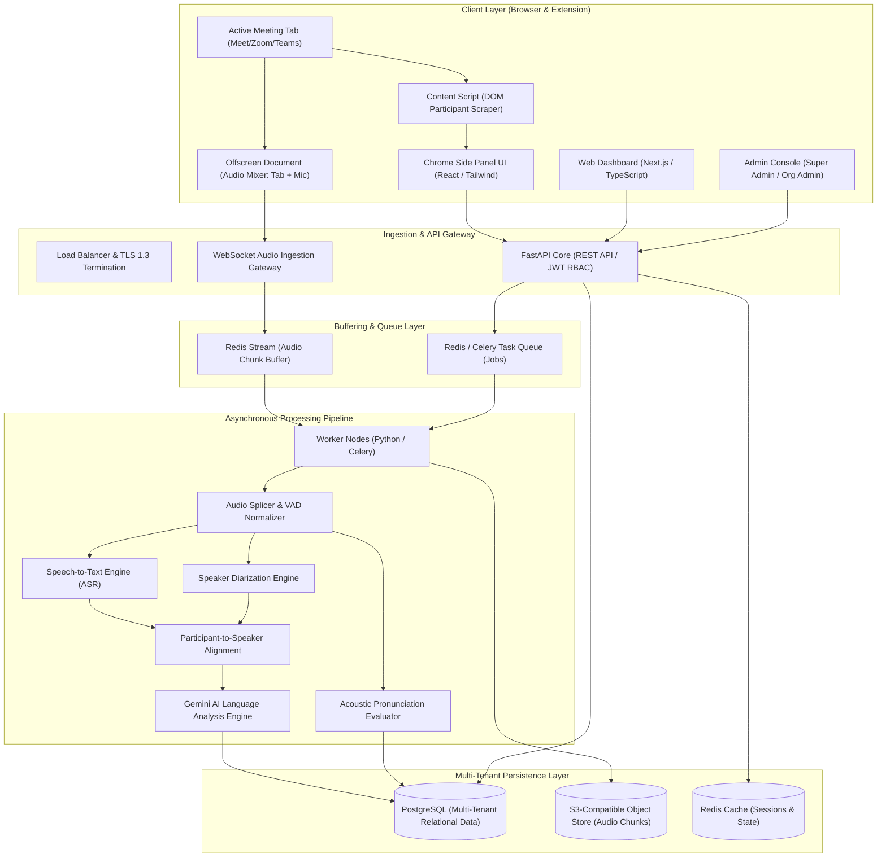
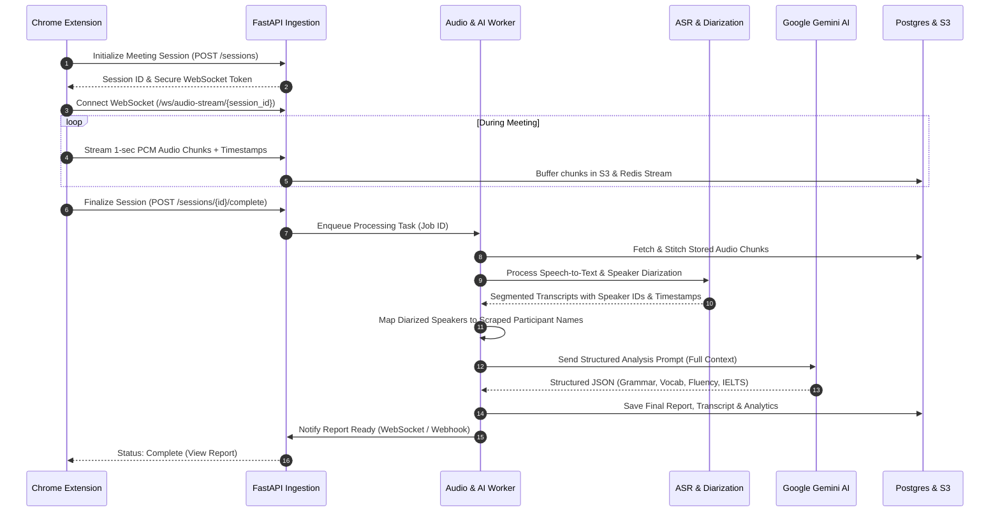

# Product Architecture & Engineering Specification

**Product Name:** AI Meeting English Coach  
**Document ID:** ARCH-V1.0-CORE  
**Status:** Approved Architectural Blueprint  
**Version:** 1.0.0  

---

## 1. High-Level Architectural Overview

The AI Meeting English Coach system is designed as a high-throughput, fault-tolerant, multi-tenant SaaS platform. It combines real-time client-side media capture within a Google Chrome Extension, low-latency binary audio streaming via WebSockets, an asynchronous worker processing pipeline, and Google Gemini AI language analysis.

---

## 2. Core Subsystems & Component Responsibilities

### 2.1 Chrome Extension Subsystem (Manifest V3)
Due to Manifest V3 service worker lifecycle constraints, the extension separates concerns across four distinct execution contexts:

1. **Background Service Worker (`service_worker.ts`):**  
   Manages extension lifecycle, authenticates against backend APIs, maintains user session tokens, coordinates between tabs, and monitors meeting tab state transitions.
2. **Content Script (`content_script.ts`):**  
   Injected into supported meeting domains (`meet.google.com`, `zoom.us`, `teams.microsoft.com`). Observes DOM mutations to detect active call status, scrapes participant names and avatar states, and listens for meeting termination events.
3. **Offscreen Document (`offscreen.html` / `offscreen.ts`):**  
   Required by Chrome Manifest V3 to execute continuous media APIs. Captures:
   - System/Tab incoming audio via `chrome.tabCapture.getMediaStreamId()`.
   - Local user microphone audio via `navigator.mediaDevices.getUserMedia()`.
   - Synchronizes, resamples, encodes into 16kHz 16-bit Mono Linear PCM or Opus chunks, and streams them over a persistent secure WebSocket connection.
4. **Side Panel UI (`sidepanel.tsx`):**  
   Provides the user with non-obtrusive controls: Meeting detection confirmation, Consent assertion, Recording Pause/Resume/Stop, live audio level meters, and one-click navigation to full web reports.

---

### 2.2 Web Dashboard Subsystem (Next.js & React)
Built with **Next.js (App Router)**, **TypeScript**, and **Tailwind CSS**:
- **Authentication & Tenant Context:** Handles enterprise SSO, email/password JWT authentication, and organization switching.
- **Interactive Transcript & Audio Player:** Synchronizes audio playback with text segments. Clicking any sentence immediately seeks the audio player to that exact millisecond.
- **English Analytics Engine:** Visualizes Grammar mistakes, Vocabulary upgrades, Fluency metrics (WPM, pause histograms, filler density), and Pronunciation breakdowns using responsive SVG charts.
- **Micro-Learning Center:** Dynamically converts meeting mistakes into personalized 3-minute daily practice challenges.

---

### 2.3 Super Admin & Enterprise Admin Console
Provides operational observability and multi-tenant management:
- **Tenant Administration:** Organization provisioning, seat limits, plan downgrades/upgrades, and billing cycles.
- **Usage & Cost Metering:** Real-time tracking of ingested meeting minutes, ASR computation time, and Gemini API token consumption.
- **System Health:** Live queue backlog monitoring, worker node throughput, and error rates.

---

### 2.4 Backend Core Subsystem (FastAPI & Python)
A high-concurrency asynchronous API service built with **Python 3.11+** and **FastAPI**:
- **RESTful Endpoints:** Serves meeting metadata, paginated transcripts, aggregated reports, user profiles, and organization billing data.
- **WebSocket Gateway (`/ws/audio-stream/{session_id}`):** High-speed ingestion of chunked binary audio. Validates sequence numbers, buffers chunks into Redis Streams, and detects network dropouts.
- **Security & RBAC Enforcement:** Validates JWT claims, organization tenant ID scoping, and enforces role-based access rules at the database query layer.

---

### 2.5 Audio Processing & AI Pipeline

1. **Audio Assembly & Normalization:** Stitches incoming audio chunks, verifies chronological sequence numbers, and applies Voice Activity Detection (VAD) to trim silence.
2. **Speech-to-Text (ASR) & Diarization:** Transcribes speech into text with millisecond-precision word timestamps and groups utterances into speaker acoustic clusters.
3. **Speaker-to-Participant Identity Mapping:** Correlates acoustic voice activity with content-script scraped participant states (e.g., active speaking indicators, local microphone presence). Segments with low confidence remain attributed to `Unknown Speaker`.
4. **Google Gemini Language Analysis Engine:** Evaluates complete conversation context using Gemini 1.5/2.0 API with **Pydantic Structured Outputs**, extracting grammatical errors, professional rephrasing, lexical variety, and estimated IELTS band scores.
5. **Acoustic Pronunciation Evaluation:** Compares speech audio against target phoneme representations to surface objective articulation feedback without accent bias.

---

## 3. Multi-Tenancy & Data Isolation Model

To guarantee strict compliance with enterprise standards and data sovereignty:

1. **Logical Tenant Partitioning:**  
   Every database table contains an indexed `tenant_id` (foreign key to `organizations`). Every query executed by FastAPI is automatically filtered by the authenticated user's `tenant_id` via dependency injection and SQLAlchemy query scopes.
2. **Audio & Media Isolation:**  
   Audio files and raw transcripts are stored in Amazon S3/MinIO using structured bucket paths:  
   `s3://meeting-coach-media/{tenant_id}/{meeting_id}/raw_audio.wav`  
   Direct object access requires short-lived presigned URLs (TTL: 15 minutes) generated only for authorized session owners.
3. **Role-Based Redaction:**  
   Individual speaking scores are private to the speaker. Organization managers and team leads only have query access to aggregated, anonymized team-level metrics unless explicit peer-sharing permissions are configured.

---

## 4. Resilience, Reconnection & Fault Recovery

| Failure Scenario | Recovery Mechanism |
|---|---|
| **Transient WebSocket Drop** | The Chrome Extension buffers binary chunks locally in memory (up to 60 seconds). Upon reconnecting, chunks are flushed in strict chronological sequence. |
| **Worker Node Crash During AI Analysis** | Celery tasks use persistent message acknowledgement (`acks_late=True`). If a worker terminates, Redis redelivers the job to an active worker node with exponential backoff (max 3 retries). |
| **Side Panel Closed Accidentally** | Capture logic resides in the persistent Background Service Worker and Offscreen Document. Closing the side panel does not interrupt audio capture or WebSocket streaming. |
| **DOM Scraper Failure (Google Meet UI Update)** | If meeting participant selectors fail due to third-party DOM changes, audio capture and ASR continue uninterrupted. Unmatched speakers are assigned labeled aliases (`Speaker 1`, `Speaker 2`), and the admin is notified via telemetry. |

