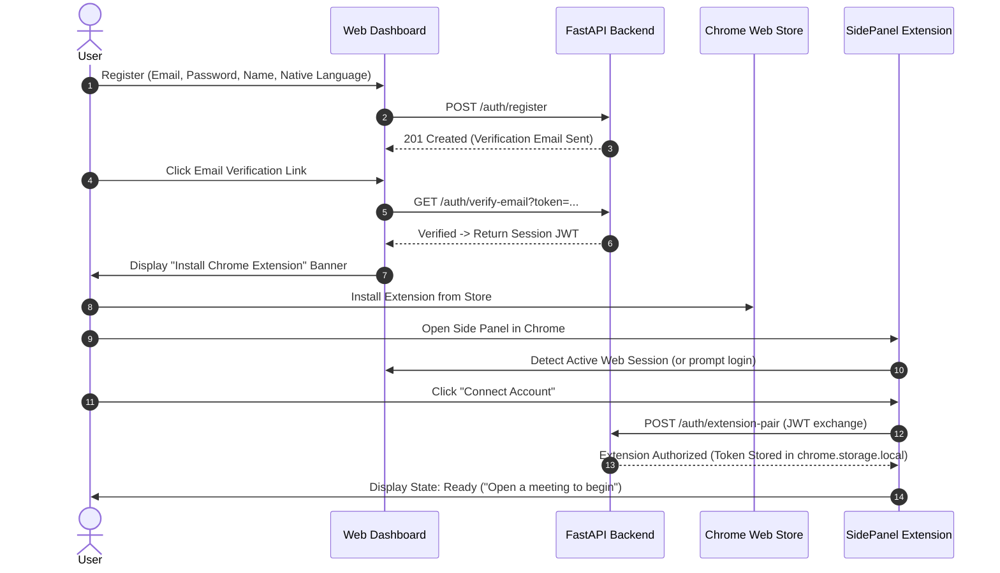
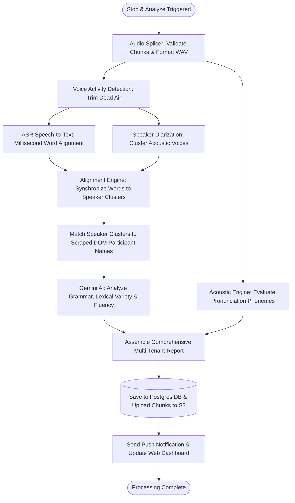
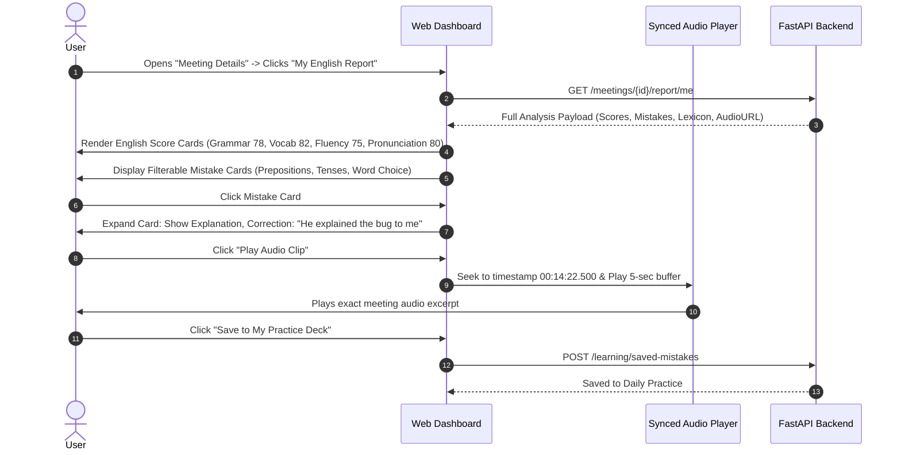

# Core User Journeys & Workflow Specifications

**Product Name:** AI Meeting English Coach  
**Document ID:** SPEC-JOURNEYS-V1.0  
**Status:** Approved Workflow Baseline  
**Version:** 1.0.0  

---

## 1. Journey Overview & Matrix

The following stateful user journeys define the exact pathways users follow across the Web Application, Chrome Extension, and Admin Panel.

```
[ Journey 01: Onboard & Pair ] ──► [ Journey 02: Detect & Consent ] ──► [ Journey 03: Live Capture ]
                                                                                   │
                                                                                   ▼
[ Journey 06: Practice Loop ] ◄─── [ Journey 05: Deep Review ] ◄──── [ Journey 04: AI Pipeline ]
```

---

## 2. Journey 01: New User Onboarding & Extension Pairing

- **Primary Actor:** Individual User / New Team Member.
- **Goal:** Create an account, verify identity, install the Chrome Extension, and pair the browser session.
- **Pre-conditions:** User has a Chromium-based browser (Chrome v116+) and an active internet connection.



### Edge Cases & Exceptions:
- **Email Token Expired:** User is shown a "Resend Link" button with rate-limiting (max 3 resends per hour).
- **Extension Cookie Blocked:** If third-party storage partitioning prevents automated auth handoff, the extension displays a 6-digit one-time pairing code to enter on the Web Dashboard.

---

## 3. Journey 02: Meeting Detection, Participant Discovery & Consent

- **Primary Actor:** Any authenticated user entering a meeting.
- **Goal:** Automatically detect the meeting room, discover participants, assert mandatory consent, and arm the recording engine.
- **Pre-conditions:** Extension is authenticated; user navigates to Google Meet, Zoom Web, or Teams Web.

```mermaid
sequenceDiagram
    autonumber
    actor User
    participant Tab as Meeting Tab (Meet/Zoom)
    participant CS as Content Script
    participant SP as Side Panel UI
    participant Off as Offscreen Document

    User->>Tab: Joins Google Meet Room
    CS->>CS: Detect URL pattern & DOM video grid
    CS->>SP: Send Message: MEETING_DETECTED (Title, URL, Platform)
    SP->>SP: Transition to "Meeting Detected" View
    CS->>CS: Scrape Participant List & Active User Name
    CS->>SP: Send Message: PARTICIPANTS_UPDATED (Names, Avatars)
    SP->>User: Display Meeting Summary & Discovered Participants
    SP->>User: Display Mandatory Consent Checkbox: "I confirm all participants consented to recording"
    User->>SP: Check Consent & Click "Start Analysis"
    SP->>Off: Send Message: START_CAPTURE (TabID, SessionParams)
    Off->>Off: Request chrome.tabCapture & getUserMedia (Mic)
    Off-->>SP: Streams Active -> Transition to "Live Recording"
```

### Edge Cases & Exceptions:
- **Microphone Permission Denied:** The Side Panel transitions to `Screen 07: Error State` with clear visual instructions on how to toggle Chrome's microphone permissions.
- **User Refuses Consent Checkbox:** The "Start Analysis" button remains disabled with a helper tooltip: *"Consent confirmation is required by law."*

---

## 4. Journey 03: Live Meeting Audio Capture & Real-Time Streaming

- **Primary Actor:** Meeting Participant.
- **Goal:** Continuously capture dual-track audio, chunk binary payloads, stream to backend via WebSocket, and provide live status feedback.

```mermaid
sequenceDiagram
    autonumber
    actor User
    participant Off as Offscreen Document
    participant SP as Side Panel UI
    participant WS as WebSocket Gateway
    participant Redis as Redis Buffer

    loop Every 1000ms
        Off->>Off: Mix/Separate Tab + Mic into 16kHz PCM Chunks
        Off->>WS: Send Binary WebSocket Message (SeqNo, Timestamp, Payload)
        WS->>Redis: Append chunk to stream: session:{id}:audio
        Off->>SP: Send Audio Level Telemetry (VU Meter DB)
        SP->>User: Update Live VU Meter & Elapsed Duration Timer
    end

    User->>SP: Click "Pause Session"
    SP->>Off: PAUSE_CAPTURE
    Off->>WS: Send Control Frame: STREAM_PAUSED
    SP->>User: Display Paused Indicator & Amber Timer

    User->>SP: Click "Resume Session"
    SP->>Off: RESUME_CAPTURE
    Off->>WS: Send Control Frame: STREAM_RESUMED

    User->>SP: Click "Stop & Analyze Meeting"
    SP->>Off: STOP_CAPTURE
    Off->>WS: Send Control Frame: STREAM_COMPLETED
    SP->>User: Transition to "Processing" Screen
```

### Edge Cases & Exceptions:
- **Network Disconnect Mid-Meeting:** The offscreen document buffers chunks in an IndexedDB fallback store. The Side Panel shows an amber banner: *"Reconnecting... audio buffered locally."* Upon reconnection, the buffered queue is flushed before live streaming resumes.

---

## 5. Journey 04: Post-Meeting AI Processing Pipeline & Report Generation

- **Primary Actor:** Backend Automation Workers & Google Gemini AI.
- **Goal:** Convert raw multi-track audio into diarized transcripts, speaker mappings, and multi-dimensional coaching reports.



---

## 6. Journey 05: Individual Report Deep-Dive & Mistake Review

- **Primary Actor:** Individual Professional.
- **Goal:** Review meeting communication performance, playback specific sentences, understand grammatical flaws, and see native rephrasing suggestions.
- **Pre-conditions:** Meeting processing has completed.



---

## 7. Journey 06: Long-Term Performance Tracking & Targeted Practice Loop

- **Primary Actor:** Individual User.
- **Goal:** Track longitudinal skill improvement over weeks/months and complete AI-generated daily micro-exercises.

1. **Dashboard Engagement:** User navigates to **My Performance** (`/my-performance`).
2. **Trend Inspection:** User inspects the 30-day Grammar Accuracy Trend line chart. Notices recurring preposition errors decreased by 25% following recent meetings.
3. **Daily Practice Trigger:** User navigates to **Learning Center** (`/learning-center`).
4. **Adaptive Drill Generation:** The platform presents 3 bite-sized daily practice questions generated by Gemini based on errors from the user's last three meetings.
5. **Interactive Completion:** User answers multiple-choice and sentence rephrasing exercises.
6. **Progress Credit:** System records streak days, marks specific mistake categories as "Mastered", and updates the user's proficiency index.

---

## 8. Journey 07: Team Manager Aggregate Performance Oversight

- **Primary Actor:** Team Manager.
- **Goal:** Benchmark team communication metrics, identify widespread training gaps, and maintain participant privacy.

1. **Manager Authentication:** Logs in with Team Manager credentials.
2. **Team Analytics Access:** Selects **Team Analytics** (`/team-analytics`).
3. **Cohort Aggregation:** Reviews aggregate metrics for the "Frontend Engineering" team over the past 30 days:
   - Average Speaking Pace: 142 WPM (Optimal).
   - Filler Word Density: 4.8% (Target: < 3.0%).
   - Top Recurring Mistake: Inconsistent Conditional Tenses (e.g., "If I will do...").
4. **Targeted Workshop Planning:** Clicks **Export Summary** to share anonymous communication focus points during the next internal team retrospective without exposing individual member embarrassment.

