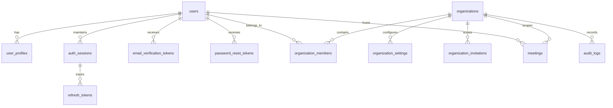

# Database Schema — SaaS Identity & Multi-Tenancy

## Entity-Relationship Overview

## Relational Tables
1. `users`: Core identity, password hash, status (`pending_verification`, `active`, `suspended`, `deactivated`), platform role, email verification timestamp.
2. `user_profiles`: Extended profile (avatar, bio, job title, speaking score goals).
3. `auth_sessions`: Active device sessions (session name, device type, IP, user-agent, last used, revoked_at).
4. `refresh_tokens`: Opaque token hashes, session reference, token family ID, used_at, revoked_at, replaced_by.
5. `email_verification_tokens`: SHA-256 token hash, user reference, 30-min expiry, used_at.
6. `password_reset_tokens`: SHA-256 token hash, user reference, 30-min expiry, used_at.
7. `organizations`: Tenant root record (name, unique slug, type, timezone, default language, seat limit, retention days).
8. `organization_settings`: Tenant policy toggles (`allow_manager_invites`, `require_2fa`, `enforce_recording_consent`).
9. `organization_members`: Junction between users and organizations with `role` (`owner`, `admin`, `manager`, `member`), `status`, and unique constraint on `(organization_id, user_id)`.
10. `organization_invitations`: Team invitations with token hash, target email, role, 7-day expiration, accepted_at, revoked_at.
11. `audit_logs`: Security and administrative audit trail with actor ID, organization ID, action, target entity, JSON details, and client IP.

