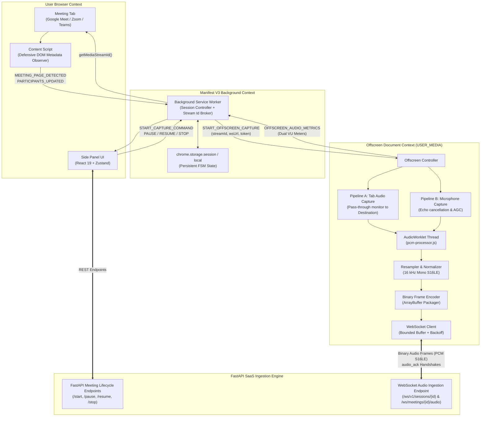
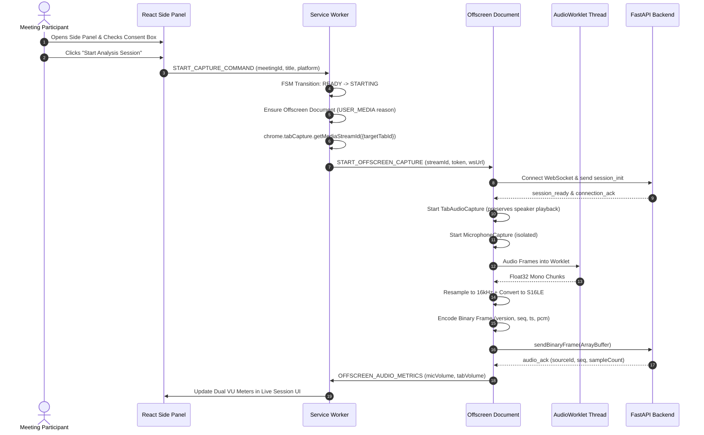

# Extension System Architecture
## Specification: Step 05 — Section 4

---

## 1. High-Level Architecture Overview

FluentMeet AI's Chrome Extension operates on a decoupled multi-context Manifest V3 architecture designed to overcome the strict limitations of Chrome service workers (no DOM access, no Web Audio API, ephemeral lifecycles) while maintaining high performance, minimal memory footprints, and security isolation.

---

## 2. Component Responsibility Matrix

| Component | Execution Context | Lifecycle | Primary Responsibilities |
|---|---|---|---|
| **Service Worker** (`service-worker.ts`) | Background Worker | Ephemeral (terminates after ~30s idle) | Extension lifecycle, action click listener, tab query & stream ID broker (`chrome.tabCapture.getMediaStreamId`), message router, offscreen lifecycle. |
| **Session Controller** (`session-controller.ts`) | Service Worker | Restores on wakeup | Manages 14-state FSM, persists session snapshot to `chrome.storage.session`, enforces valid transitions. |
| **Offscreen Document** (`offscreen.html` / `offscreen.ts`) | Hidden HTML DOM Context | Active during recording | Hosts DOM/Web Audio APIs, manages `AudioContext`, loads `AudioWorklet`, runs WebSocket streaming client. |
| **Tab Audio Capture** (`tab-audio-capture.ts`) | Offscreen Document | Active during recording | Consumes tab stream ID via `getUserMedia()`, preserves speaker playback via `sourceNode.connect(audioContext.destination)`. |
| **Microphone Capture** (`microphone-capture.ts`) | Offscreen Document | Active during recording | Captures local microphone with hardware acoustic echo cancellation and noise suppression. |
| **AudioWorklet Processor** (`pcm-processor.ts`) | Dedicated Audio Rendering Thread | Runs at AudioContext clock | Gathers 128-frame blocks, downmixes to mono, and emits raw Float32 chunks. |
| **Audio Resampler & Normalizer** (`audio-resampler.ts`) | Offscreen Document | Synchronous chunk worker | Linear interpolation downsampling to 16 kHz, Int16 S16LE conversion, RMS/Peak/Clipping metrics calculation. |
| **Binary Audio Encoder** (`audio-encoder.ts`) | Offscreen Document | Per-chunk serializer | Serializes chunk metadata and raw PCM into compact 23+N byte binary `ArrayBuffer`. |
| **Platform Adapters** (`platforms/*`) | Content Script & Service Worker | Document lifecycle | Matches URLs, queries DOM selectors defensively, monitors participant join/leave events. |
| **Side Panel UI** (`ExtensionApp.tsx`) | Chrome Side Panel | User toggled | Renders 15 reactive screens, displays real-time dual VU signal meters, triggers capture commands. |

---

## 3. End-to-End Capture Sequence

---

## 4. Service Worker Sleep Recovery Guarantee

Chrome terminates Manifest V3 Service Workers after roughly 30 seconds of inactivity. To prevent state loss:
1. `SessionController` immediately synchronizes every state transition and active metadata update to `chrome.storage.session` (in-memory persistent storage for the browser session).
2. On any incoming message or wakeup event, `sessionController.restoreState()` immediately hydrates the active session snapshot.
3. The actual long-running media streams and WebSocket connection reside within the **Offscreen Document**, which Chrome does not terminate while audio capture nodes remain active.
4. If the browser or extension restarts, the state machine restores to `IDLE` or prompts the user with the action state, preventing orphaned sessions.

