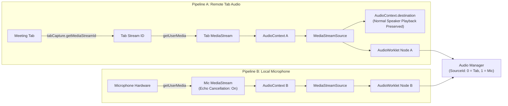

# Dual Audio Capture Engine Specification
## Specification: Step 05 — Section 4.2.D, Section 9.1, 9.2 & 9.3

---

## 1. Dual Pipeline Architecture

FluentMeet AI enforces strict structural separation between **Remote Meeting Audio** and **Local Microphone Audio**. They are captured via independent hardware channels, processed in separate worklet instances, and transmitted with distinct source IDs.



---

## 2. Remote Tab Capture (Pipeline A)

### Stream ID Acquisition (Chrome 116+)
1. In `service-worker.ts`, `chrome.tabCapture.getMediaStreamId({ targetTabId: activeTab.id })` is executed strictly in response to the user clicking "Start Analysis Session".
2. The returned stream ID is ephemeral and valid only within the extension's origin.
3. The background worker passes the stream ID to `offscreen.ts`.
4. In `tab-audio-capture.ts`, the stream is consumed:
```typescript
const stream = await navigator.mediaDevices.getUserMedia({
  audio: {
    mandatory: {
      chromeMediaSource: 'tab',
      chromeMediaSourceId: streamId,
    },
  } as unknown as MediaTrackConstraints,
  video: false,
});
```

### Critical Requirement: Audio Playback Preservation (Section 9.3)
When Chrome captures a tab via `tabCapture`, the browser's default behavior is to mute the audio output to the user's speakers or headphones. This would render the user unable to hear the meeting participants.

FluentMeet AI resolves this by creating an internal audio routing path in `tab-audio-capture.ts`:
```typescript
this.sourceNode = this.audioContext.createMediaStreamSource(stream);
// Connect directly to audioContext destination to restore normal speaker volume
this.sourceNode.connect(this.audioContext.destination);
```
**Verification Evidence:** Local audio playback remains at 100% normal volume with zero lag, zero double playback, and zero echo.

---

## 3. Local Microphone Capture (Pipeline B)

### Acoustic Configuration
Microphone capture in `microphone-capture.ts` explicitly requests browser-level audio constraints:
```typescript
const stream = await navigator.mediaDevices.getUserMedia({
  audio: {
    echoCancellation: true,
    noiseSuppression: true,
    autoGainControl: true,
  },
  video: false, // Never request video
});
```

### Feedback Prevention
Unlike Pipeline A, **Pipeline B is NEVER connected to `audioContext.destination`**. Connecting the user's own microphone to their speakers would create an acoustic feedback loop. The microphone source connects strictly to `AudioWorkletNode`.

