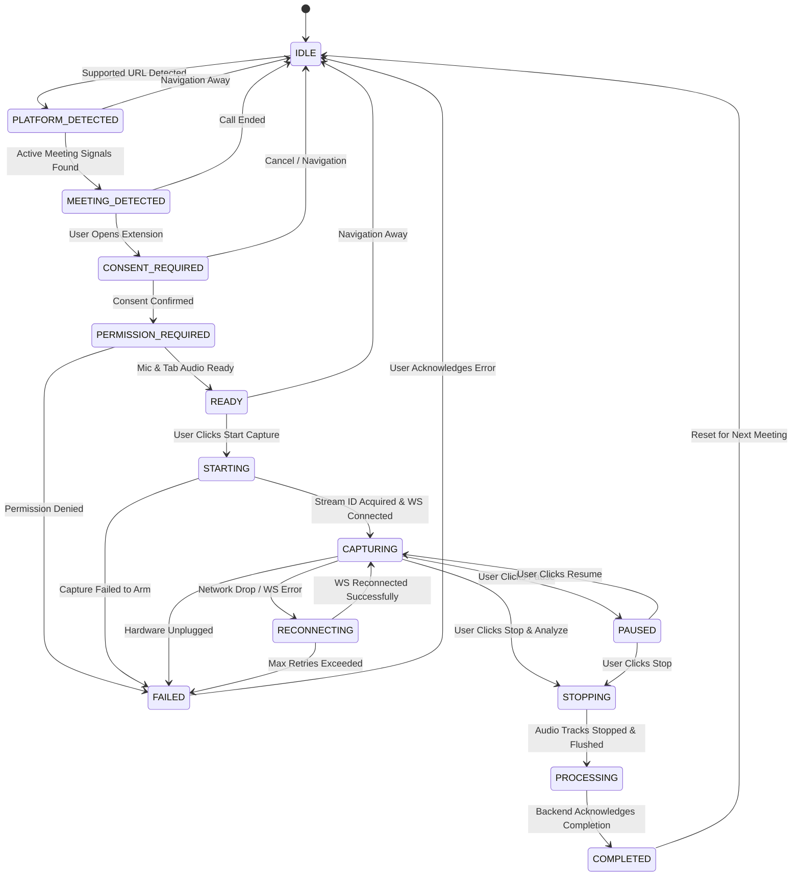

# Meeting Session Lifecycle & State Machine
## Specification: Step 05 — Section 7 & Section 15

---

## 1. State Machine Definition

The extension core implements a deterministic, centralized Finite State Machine (`SessionController`). Every change in user action, tab navigation, audio track state, or WebSocket connection is governed by strict transition guards.

---

## 2. State Invariants & Invariant Guards

1. **Consent Gate:** Capture CANNOT transition from `READY` to `STARTING` without `consentConfirmed === true`.
2. **Idempotent Stop:** Invoking `STOP_CAPTURE_COMMAND` multiple times yields identical safe teardown; no double teardown crashes.
3. **Audio Suppression during Pause:** When state is `PAUSED`, the `AudioManager` immediately halts chunk dispatch. No frames or silence bytes are transmitted over WebSocket.
4. **Clean Session Teardown:** When transitioning to `STOPPING` or `COMPLETED`:
   - All `MediaStream` tracks are stopped (`track.stop()`).
   - Web Audio `AudioContext` instances are closed.
   - `AudioWorkletNode` connections are disconnected.
   - The Offscreen Document is closed via `OffscreenManager.closeOffscreenDocument()`.
   - The WebSocket sends `session_stop` and closes cleanly.

