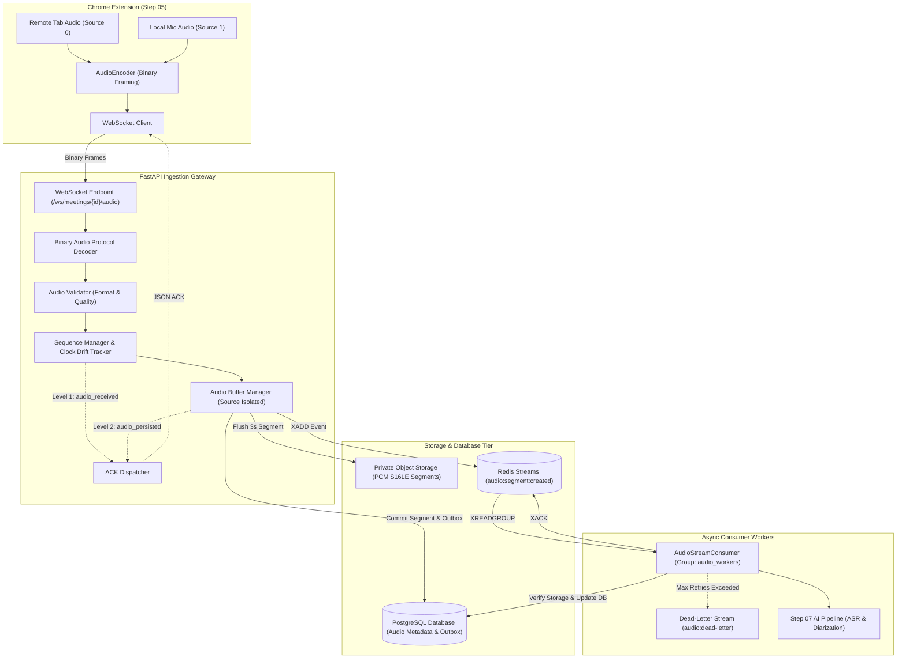
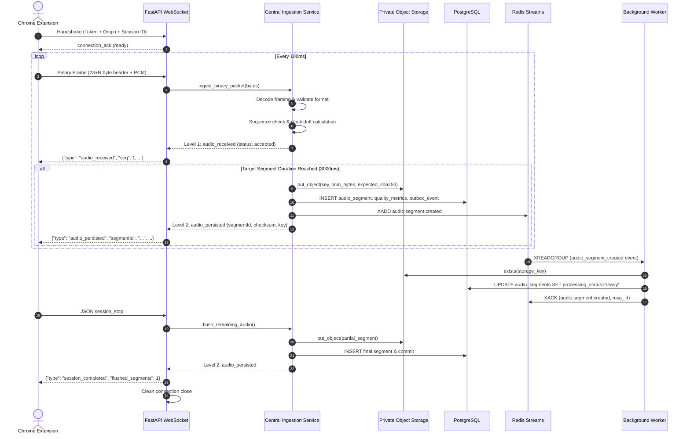

# System Architecture — Step 06 Audio Ingestion & Streaming Backend

## 1. Architectural Overview

The Step 06 Audio Ingestion & Processing backend is engineered for ultra-reliable, high-concurrency real-time stream ingestion. It decouples high-frequency network I/O from storage and downstream AI compute tasks using memory-bounded buffering, transactional persistence, and event-driven worker distribution.

---

## 2. Audio Pipeline Separation

A core foundational principle of FluentMeet AI is the absolute separation of the two independent audio sources:
* **Pipeline A (`source_id = 0`):** Remote Meeting Audio captured from the browser tab via `chrome.tabCapture.getMediaStreamId()`. Represents all remote speakers in the Google Meet, Teams, or Zoom session.
* **Pipeline B (`source_id = 1`):** Local Microphone Audio captured from the user's headset or microphone via `navigator.mediaDevices.getUserMedia()`. Represents the single coached learner.

### Isolation Rules
1. **No Mixed Buffers:** Buffering occurs inside separate dictionaries indexed by `source_id`. Under no circumstances are samples summed, interleaved, or shared across source buffers.
2. **Independent Monotonic Sequences:** Each source tracks its own sequence counter starting at 1. Chunk drops or gaps in Source 0 do not impact Source 1 sequence evaluation.
3. **Dedicated Object Keys:** Storage paths explicitly segregate sources:
   `.../sources/0/segments/{id}.pcm` vs `.../sources/1/segments/{id}.pcm`.
4. **Distinct AI Targets in Step 07:** Downstream models perform speaker diarization on Pipeline A, while Pipeline B undergoes high-fidelity phonetic pronunciation, grammar, and vocabulary scoring.

---

## 3. End-to-End Sequence Diagram

