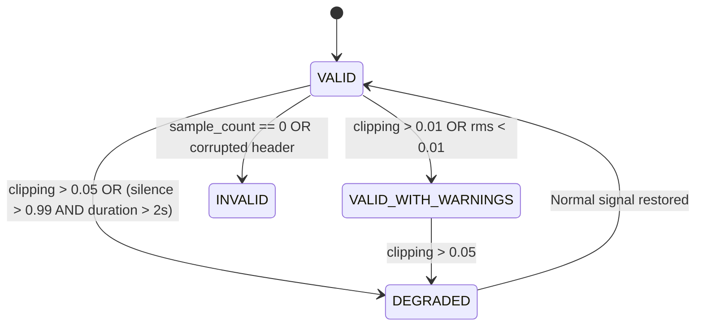

# Audio Validation & Quality Diagnostics Engine

## 1. Format & Parameter Validation

Every incoming binary audio frame is verified against immutable negotiated criteria before buffering:
1. **Sample Rate:** Strictly `16,000 Hz` (verified against `AudioValidator.SUPPORTED_SAMPLE_RATES`).
2. **Channel Count:** Strictly `1` (Mono). Multichannel audio is rejected with `AudioValidationError`.
3. **Encoding:** Integer signed 16-bit little-endian (`pcm_s16le`).
4. **Byte Alignment:** $L_{\text{bytes}} \pmod 2 = 0$. Odd byte lengths trigger immediate rejection.
5. **Sample Count Consistency:** Validates that $L_{\text{bytes}} = 2 \times \text{sample\_count}$.

---

## 2. Signal Quality Diagnostics (NumPy Vectorized)

Upon segment completion or diagnostic sampling, the backend calculates four real-time acoustic quality indicators:

### 1. Root Mean Square (RMS) Level
Calculates effective acoustic energy normalized to $[0.0, 1.0]$:
$$x_{\text{norm}}[i] = \frac{x[i]}{32768.0}$$
$$\text{RMS} = \sqrt{\frac{1}{N} \sum_{i=0}^{N-1} (x_{\text{norm}}[i])^2}$$

### 2. Peak Amplitude
Captures the absolute maximum signal excursion:
$$\text{Peak} = \max_{0 \le i < N} |x_{\text{norm}}[i]|$$

### 3. Clipping Ratio
Detects digital saturation where samples touch the 16-bit integer rails ($\ge 32765$ or $\le -32765$):
$$\text{Clipping Ratio} = \frac{\sum [|x[i]| \ge 32765]}{N}$$
* **Threshold:** A clipping ratio $> 0.05$ (5%) triggers `DEGRADED` status.

### 4. Silence Ratio
Identifies dead microphone channels or prolonged dropouts by measuring samples with $|x_{\text{norm}}[i]| < 0.005$:
$$\text{Silence Ratio} = \frac{\sum [|x_{\text{norm}}[i]| < 0.005]}{N}$$

---

## 3. Quality Classification State Machine

* **`VALID`:** Healthy signal suitable for high-accuracy Speech-to-Text and pronunciation grading.
* **`VALID_WITH_WARNINGS`:** Minor clipping or quiet speaker; STT operates normally, but extension receives a volume warning toast.
* **`DEGRADED`:** Severe acoustic clipping or prolonged dead mic; flagged in meeting quality report.
* **`INVALID`:** Corrupt PCM payload; chunk rejected and logged.
