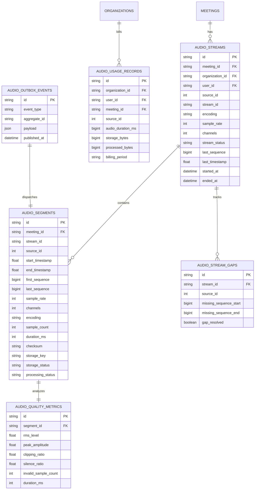

# Database Design & Transactional Outbox Pattern

## 1. Entity-Relationship Schema

The Step 06 persistence layer is designed around 7 core tables mapped in SQLAlchemy (`app/models/audio.py`):

---

## 2. Transactional Outbox Pattern

To prevent distributed dual-write inconsistencies between PostgreSQL and Redis Streams:
1. When an audio segment completes, `db.add(db_segment)` and `db.add(outbox_event)` occur in the **same database transaction**.
2. If the process terminates before publishing to Redis:
   * The un-published event remains in `audio_outbox_events` with `published_at IS NULL`.
   * A periodic outbox relay worker scans for pending outbox events and publishes them to Redis.
3. Once published, `published_at` is stamped.
