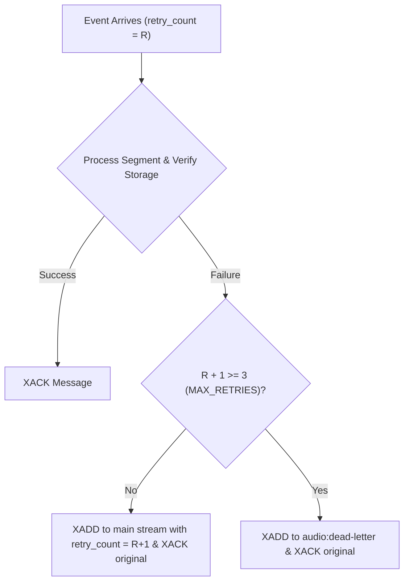

# Redis Streams Event Transport & Worker Group

## 1. Stream Architecture & Event Schema

Redis Streams acts as the high-throughput, low-latency event transport connecting the FastAPI ingestion tier to background worker pools.

### Separation Rule: Events in Redis, Audio in Storage
* **Prohibited:** Storing raw audio binary bytes in Redis.
* **Standard:** Publishing light metadata events containing storage keys, checksums, and sequence boundaries.

### Event Format: `audio:segment:created`
```json
{
  "event_type": "audio_segment_created",
  "aggregate_id": "28d9cb16-4354-466a-8841-6ffd31a98fd8",
  "payload": {
    "segment_id": "28d9cb16-4354-466a-8841-6ffd31a98fd8",
    "meeting_id": "meet-614ef-908a",
    "organization_id": "org-acme-1",
    "stream_id": "stream-0",
    "source_id": 0,
    "storage_key": "organizations/org-acme-1/meetings/meet-614ef-908a/streams/stream-0/sources/0/segments/28d9cb16-4354-466a-8841-6ffd31a98fd8.pcm",
    "duration_ms": 3000,
    "sample_count": 48000,
    "checksum": "686d4b0e6b87db8e279d3822aa44189000ee4a2328858275ef9e930576b3ca00"
  }
}
```

---

## 2. Consumer Group Processing

* **Stream:** `audio:segment:created`
* **Group Name:** `audio_workers`
* **Consumer ID:** `worker-{uuid}`
* **Reading:** `XREADGROUP GROUP audio_workers worker-1 COUNT 10 BLOCK 1000 STREAMS audio:segment:created >`

### Processing Lifecycle:
1. Decode JSON payload.
2. Verify segment file exists in object storage (`storage.exists(storage_key)`).
3. Update `audio_segments.processing_status = 'ready_for_transcription'`.
4. Acknowledge message: `XACK audio:segment:created audio_workers {message_id}`.

---

## 3. Failure Recovery & Dead-Letter Routing



### Stale Message Reclaim (`XAUTOCLAIM`)
If a worker crashes or encounters an Out-Of-Memory (OOM) kill while holding unacknowledged messages:
* Other active consumers periodically invoke `XAUTOCLAIM` with `min_idle_time = 60000ms` (60 seconds).
* Stalled messages in the Pending Entries List (PEL) are automatically transferred to healthy consumers and reprocessed.
