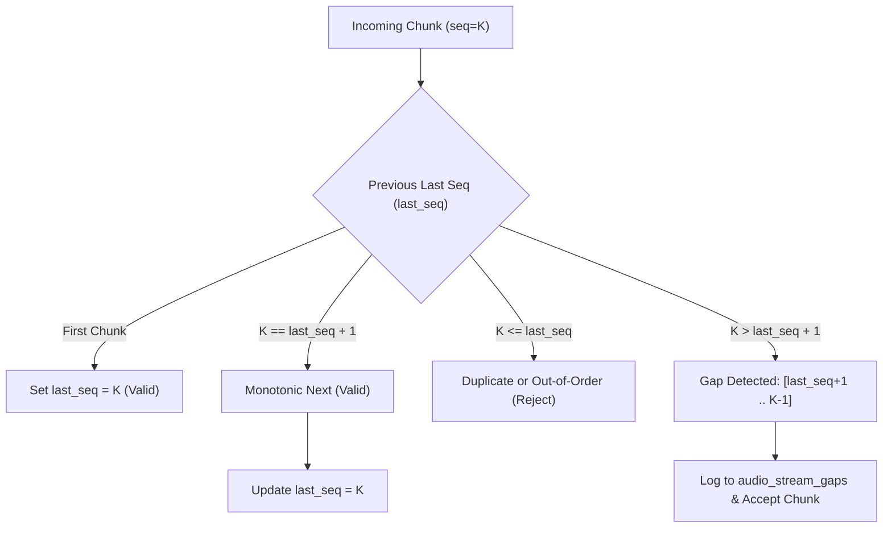

# Stream Synchronization, Sequence Management & Clock Drift

## 1. Sequence Management & Gap Detection

Network jitter, packet drops, or browser tab hibernation can cause chunk loss or out-of-order arrival. The `SequenceManager` enforces monotonicity per source:

### Gap Recording
When a jump occurs, an entry is inserted into `audio_stream_gaps`:
* `missing_sequence_start = last_seq + 1`
* `missing_sequence_end = K - 1`
* `gap_resolved = false`

---

## 2. Timeline Synchronization & Clock Drift Calculation

Browser Web Audio API clocks can drift relative to server wall clocks due to audio hardware crystal oscillator variations, CPU throttling, or buffer underruns.

### Drift Formula
Let:
* $t_0$: Timestamp of the initial chunk in the session.
* $t_{\text{start}}$: Reported session-relative timestamp of the current incoming chunk.
* $S_{\text{prior}}$: Total cumulative audio samples ingested prior to this chunk.
* $R$: Audio sample rate ($16,000 \text{ Hz}$).

The expected duration of audio ingested before this chunk is:
$$D_{\text{prior}} = \left( \frac{S_{\text{prior}}}{R} \right) \times 1000 \quad [\text{ms}]$$

The elapsed monotonic time is:
$$\Delta T = t_{\text{start}} - t_0 \quad [\text{ms}]$$

The instantaneous clock drift is:
$$\text{Clock Drift} = |\Delta T - D_{\text{prior}}| \quad [\text{ms}]$$

### Thresholds & Actions
* **Normal Range ($\le 200 \text{ ms}$):** Smooth playback; drift handled via sample alignment.
* **Warning Range ($> 200 \text{ ms}$):** Flagged as `is_drift_warning = True` in diagnostics; downstream diarizer warned of possible cross-source timestamp skew.
* **Discontinuity ($> 1000 \text{ ms}$ gap or negative jump):** Flagged as `is_discontinuous = True`.
