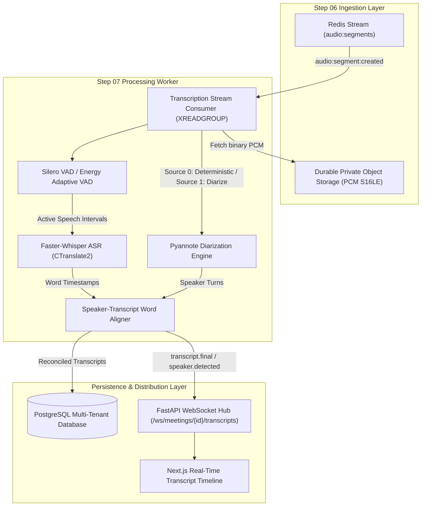

# Step 07 — Architecture Design: Speech-to-Text & Speaker Diarization

## 1. System Overview
Step 07 provides an end-to-end open-source speech recognition and speaker attribution pipeline designed for high-concurrency SaaS meetings. It processes 16 kHz Mono PCM audio segments from Step 06 and produces structured transcripts with word-level millisecond timestamps and unambiguous speaker turns.

## 2. Core Components

### 2.1 Dual-Channel Stream Topology
- **Source 0 (Local User Microphone):**
  - Originates from `navigator.mediaDevices.getUserMedia()`.
  - Deterministically mapped to `speaker_user_me` ("You (Host)") with confidence 0.99.
  - Zero diarization clustering required for Source 0, eliminating identity confusion.
- **Source 1 (Remote Meeting Audio):**
  - Originates from `chrome.tabCapture.getMediaStreamId()`.
  - Transmitted as mixed remote audio stream.
  - Routed through `PyannoteDiarizationProvider` to separate distinct speakers into `speaker_001`, `speaker_002`, etc.

### 2.2 Processing Pipeline Lifecycle
1. **Segment Ingestion:** Worker consumes `audio:segment:created` from Redis Stream `audio:segments`.
2. **Audio Fetch:** Worker retrieves byte-verified PCM data from `AudioObjectStorage`.
3. **Voice Activity Detection (VAD):** Silero VAD evaluates RMS, zero-crossing rate, and spectral density. If pure silence, processing completes without invoking heavy ASR compute.
4. **Speech-to-Text (ASR):** `FasterWhisperASRProvider` executes CTranslate2 batched inference, extracting word tokens with start/end millisecond timestamps and raw confidence probabilities.
5. **Diarization:** `PyannoteDiarizationProvider` detects speaker boundaries and computes turn intervals.
6. **Alignment:** `SpeakerTranscriptAligner` maps every word token to its optimal speaker turn via temporal intersection maximization.
7. **Storage & Distribution:** Database transactions write to `meeting_speakers`, `transcript_segments`, `transcript_words`, `speaker_turns`, and `speech_overlaps`. Events are published to Redis and broadcast over WebSockets.
