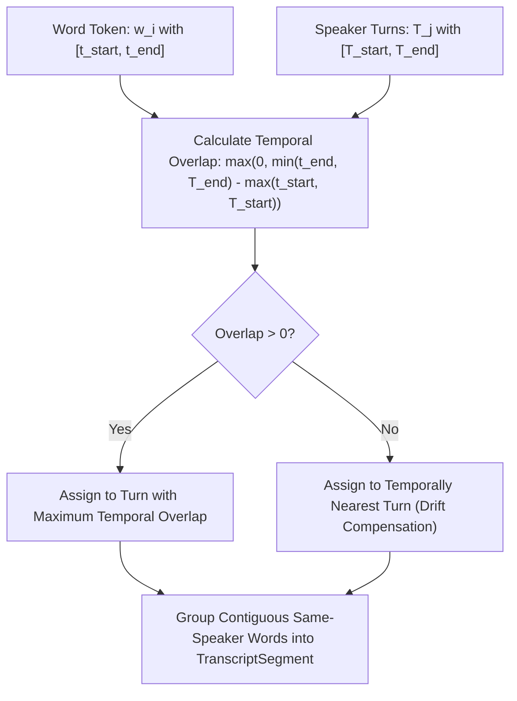

# Step 07 — Speaker-Transcript Alignment Engine

## 1. The Alignment Problem
ASR models (Whisper) output word tokens with precise temporal bounds $[t_{\text{start}}, t_{\text{end}}]$, while Diarization models (Pyannote) output speaker turn intervals $[T_{\text{start}}, T_{\text{end}}]$ with speaker labels. The Alignment Engine resolves these independent timelines into unified, speaker-attributed utterances.

## 2. Alignment Algorithm

### 2.1 Overlap Maximization
For each word $w$ and speaker turn $T$:
$$\text{Overlap}(w, T) = \max\left(0, \min(w.\text{end\_ms}, T.\text{end\_ms}) - \max(w.\text{start\_ms}, T.\text{start\_ms})\right)$$
The speaker for $w$ is:
$$\text{Speaker}(w) = \arg\max_{T} \text{Overlap}(w, T)$$

### 2.2 Boundary Drift Compensation
If $\max_T \text{Overlap}(w, T) = 0$ due to minor timestamp drift at the start or end of an utterance, the word is assigned to the turn with the minimum distance:
$$\text{Distance}(w, T) = \min\left(|w.\text{start\_ms} - T.\text{end\_ms}|, |w.\text{end\_ms} - T.\text{start\_ms}|\right)$$

### 2.3 Utterance Synthesis & Splitting
- Once all words are attributed, contiguous words sharing the same `speaker_label` are coalesced into a single `TranscriptSegment`.
- If a speaker turn changes mid-sentence, the sentence is split cleanly at the speaker turn boundary.
- Granular word timestamps are retained in `transcript_words` for millisecond-level UI navigation.
