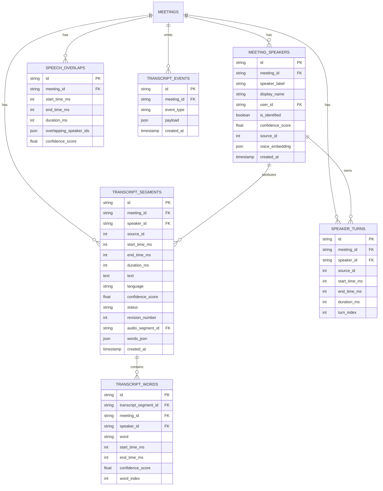

# Step 07 — Multi-Tenant Database Design & Schema

## 1. Relational Entity Diagram

## 2. Table Specifications & Indexing Strategy

### 2.1 `meeting_speakers`
- Unique constraint: `(meeting_id, speaker_label)`
- Indexes: `ix_meeting_speakers_meeting_id`, `ix_meeting_speakers_meeting_source`

### 2.2 `transcript_segments`
- Composite index: `(meeting_id, start_time_ms, end_time_ms)` for high-performance chronological queries.
- Status index: `(meeting_id, status)` for fast filtering of active or corrected revisions.

### 2.3 `transcript_words`
- Composite index: `(meeting_id, start_time_ms)` for instant seeking during audio playback.

### 2.4 `speaker_turns` & `speech_overlaps`
- Interval index: `(meeting_id, start_time_ms, end_time_ms)` for conversational pacing metrics.

## 3. Database Migrations
Step 07 tables are managed via Alembic revision `003_transcript_diarization.py` located at `services/api/migrations/versions/003_transcript_and_diarization_schema.py`.
