# Step 08 — Architecture Design: AI English Analysis Engine

## 1. System Topology & Data Flow

```mermaid
flowchart TD
    subgraph Input["Step 07 Finalized Transcripts"]
        TS["transcript_segments"]
        TW["transcript_words"]
        MS["meeting_speakers"]
    end

    subgraph Orchestrator["Analysis Orchestrator"]
        Val["Input Validator & Tenant Authorization"]
        Prep["Transcript Preprocessing & Context Extraction"]
        Chunk["Context-Preserving Chunk Builder"]
        SecCheck["Prompt Injection Sanitizer"]
    end

    subgraph Modules["Logical Intelligence Modules"]
        M1["Grammar Intelligence"]
        M2["Vocabulary Intelligence"]
        M3["Fluency & Timing Analytics"]
        M4["Sentence Structure Analysis"]
        M5["Communication & Relevance"]
        M6["Speaking Pattern Tracker"]
    end

    subgraph LLM["Google Gemini API Gateway"]
        Gemini["Gemini REST Client (v1beta/gemini-2.5-flash)"]
        Schema["Structured JSON Schema Validator (Pydantic)"]
    end

    subgraph QualityGate["Evidence & Scoring Engine"]
        EvidCheck["Transcript Segment & Text Match Verification"]
        ScoreEng["Weighted Category Scorer (0-100)"]
        RecEng["Personalized Recommendation Engine"]
    end

    subgraph Persistence["PostgreSQL Database"]
        AS_DB[("analysis_sessions")]
        PA_DB[("participant_analysis")]
        GI_DB[("grammar_issues")]
        VI_DB[("vocabulary_insights")]
        FM_DB[("fluency_metrics")]
        CI_DB[("communication_insights")]
        IR_DB[("improvement_recommendations")]
    end

    subgraph Output["Consumer Interfaces"]
        API["FastAPI REST Endpoints (/api/v1/analysis)"]
        Dash["Next.js Meeting Analysis Dashboard"]
    end

    Input --> Val
    Val --> Prep
    Prep --> Chunk
    Chunk --> SecCheck
    SecCheck --> Modules
    Modules --> Gemini
    Gemini --> Schema
    Schema --> EvidCheck
    EvidCheck --> ScoreEng
    ScoreEng --> RecEng
    RecEng --> Persistence
    Persistence --> API
    API --> Dash
```

## 2. Core Architectural Pillars

### 2.1 Single Orchestrator Architecture
Rather than running multiple heavy AI agents, a single `AnalysisOrchestrator` controls execution flow:
- Validates the meeting state (`status == "completed"` or `"finalized"`).
- Organizes segments by speaker and builds structured prompts.
- Submits calls to the Gemini API with structured output schema definitions.
- Verifies every finding against the database before committing results.

### 2.2 Evidence Gate Mechanism
Before any linguistic finding (grammar mistake, vocabulary suggestion) is accepted into `participant_analysis`:
1. **Segment ID Check:** The cited `transcript_segment_id` must exist in `transcript_segments`.
2. **Text Containment Check:** The `original_text` identified by the model must actually appear within that segment.
3. **Attribution Check:** The segment must belong to the target participant/speaker.
If any check fails, the finding is discarded and logged, preventing hallucinations from contaminating user scores.
