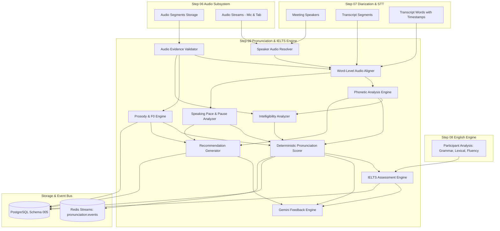

# Step 09 — Architecture & System Design

## 1. High-Level System Architecture

The Pronunciation Analysis & IELTS-Style English Assessment Engine bridges physical audio captured in Step 06 and verified word-level transcription produced in Step 07.



---

## 2. Component Directory Layout

```
services/api/app/
├── models/
│   └── pronunciation.py               # 7 relational entities
├── schemas/
│   └── pronunciation.py               # Pydantic request & response models
├── api/v1/
│   └── pronunciation.py               # REST endpoints
├── pronunciation/
│   ├── validation/
│   │   ├── evidence_validator.py      # SNR, clipping, silence metrics
│   │   └── speaker_resolver.py        # Dual-track audio routing
│   ├── alignment/
│   │   └── word_aligner.py            # Word timestamp boundary clamping & PCM slicing
│   ├── acoustic/
│   │   ├── phonetics.py               # CMU lexicon & spectral friction ratio
│   │   ├── prosody.py                 # F0 autocorrelation, intonation & syllable stress
│   │   ├── pace.py                    # WPM & pause taxonomy
│   │   └── intelligibility.py         # Accent-neutral listener comprehension
│   ├── scoring/
│   │   ├── pronunciation_scorer.py    # 0-100 rubric & minimum 5-word gate
│   │   └── ielts_engine.py            # 4-dimension practice estimate
│   ├── feedback/
│   │   ├── recommendation_generator.py# Minimal pairs & prosody exercises
│   │   └── gemini_feedback.py         # Structured JSON telemetry explanation
│   └── orchestrator.py                # End-to-end pipeline coordinator
```

---

## 3. Execution Data Flow

1. **Trigger**: REST API `POST /api/v1/meetings/{id}/pronunciation` or Redis Stream `pronunciation:jobs` initiates execution.
2. **Resolution & Validation**: The orchestrator matches speakers with audio streams (`local_mic` vs `remote_mix`), loads PCM binary buffers, and verifies SNR, clipping, and silence ratios.
3. **Alignment**: Individual words from `TranscriptWord` are aligned to acoustic intervals. Boundary clamping ensures PCM slices do not exceed speech boundaries.
4. **Phonetic Analysis**: Aligned PCM slices undergo FFT spectral analysis. High-frequency fricative ratios (>2500Hz) and plosive bursts are evaluated against the reference ARPAbet lexicon.
5. **Prosody & Pace**: F0 pitch contour is extracted via normalized autocorrelation. Intonation dynamics, syllable stress, WPM, and pause classifications are generated.
6. **Scoring & IELTS Synthesis**: Deterministic 0–100 scores are calculated. Step 08 grammar, lexical, and fluency metrics are merged to generate an IELTS-style indicative band (0.5 increments) with qualitative descriptors.
7. **Recommendations & Persistence**: Targeted minimal pair drills are generated and persisted into PostgreSQL with a completion event dispatched to Redis.

