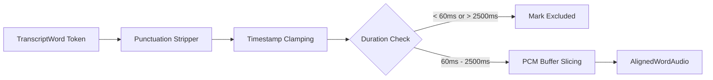

# Step 09 — Word-Level Audio Alignment Pipeline

## 1. Overview & Alignment Mechanics

In order to analyze phoneme production, vowel length, and consonant transitions, transcribed words from Step 07 (`TranscriptWord`) must be mapped to exact millisecond intervals within physical audio PCM buffers.

The `WordAlignmentProcessor` performs token normalization, timestamp boundary clamping, duration filtering, and physical PCM buffer slicing.

---

## 2. Alignment Pipeline Steps

### 2.1 Token Normalization
- Removes peripheral punctuation (e.g., `"think,"` $\rightarrow$ `"think"`, `'"architecture"'` $\rightarrow$ `"architecture"`).
- Preserves internal grammatical contractions (e.g., `"don't"`, `"we're"`).
- Lowercases tokens for dictionary lookup.

### 2.2 Boundary Clamping
- Prevents word timestamp drift from extending outside segment bounds.
- If $W_{\text{start}} < S_{\text{start}}$, clamps $W_{\text{start}} = S_{\text{start}}$.
- If $W_{\text{end}} > S_{\text{end}}$, clamps $W_{\text{end}} = S_{\text{end}}$.
- Clamped words receive status `boundary_clamped`.

### 2.3 Duration Thresholds
- **Minimum Duration**: Spoken English words require at least $60\text{ ms}$ for phonetic articulation. Words $< 60\text{ ms}$ are flagged as `excluded` (`Word duration below minimum threshold`).
- **Maximum Duration**: Single words exceeding $2500\text{ ms}$ indicate ASR timestamp hallucination or sustained background hum and are excluded.

### 2.4 PCM Buffer Slicing
- Slices the segment's raw 16-bit 16kHz PCM buffer at byte offsets:
  $$\text{Byte Offset Start} = \left\lfloor \frac{W_{\text{rel\_start\_ms}}}{1000.0} \times 16000 \right\rfloor \times 2$$
  $$\text{Byte Offset End} = \left\lfloor \frac{W_{\text{rel\_end\_ms}}}{1000.0} \times 16000 \right\rfloor \times 2$$
- Yields a dedicated byte slice attached to `AlignedWordAudio.audio_pcm_slice` for FFT spectral processing.

