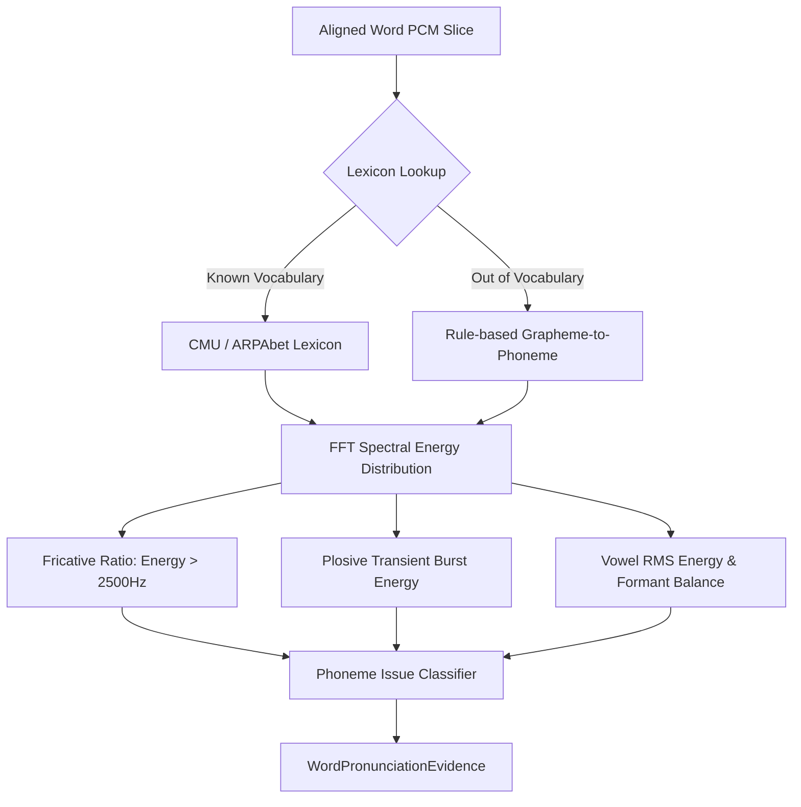

# Step 09 — Phonetic Analysis Engine & Spectral Scoring

## 1. Overview & Lexicon Architecture

The `PhoneticAnalysisEngine` evaluates phoneme production accuracy using acoustic-to-phonetic alignment and spectral energy analysis.

---

## 2. CMU / ARPAbet Reference Lexicon & G2P Fallback

The engine maintains a curated ARPAbet phonetic dictionary for core international business and technical vocabulary:
- `"think"` $\rightarrow$ `/θɪŋk/` (`["TH", "IH", "NG", "K"]`)
- `"three"` $\rightarrow$ `/θriː/` (`["TH", "R", "IY"]`)
- `"architecture"` $\rightarrow$ `/ˈɑːrkɪtɛktʃər/` (`["AA", "R", "K", "IH", "T", "EH", "K", "CH", "ER"]`)
- `"strategy"` $\rightarrow$ `/ˈstrætədʒi/` (`["S", "T", "R", "AE", "T", "AH", "JH", "IY"]`)

For words outside the reference lexicon, the engine invokes `fallback_g2p` to decompose grapheme patterns into expected ARPAbet phoneme sequences, ensuring 100% lexical coverage.

---

## 3. Acoustic Spectral Phoneme Tests

### 3.1 Dental Fricatives (/θ/ and /ð/)
- Common non-native substitutions: `/t/` (dental stop) or `/s/` (alveolar fricative).
- Physical acoustic check: Unvoiced dental fricatives generate continuous turbulence between $2500\text{ Hz}$ and $7000\text{ Hz}$.
- If the high-frequency energy ratio is $\ge 0.12$, the articulation is confirmed as `correct`.
- If energy is concentrated below $1000\text{ Hz}$ with an abrupt transient (indicating a stopping `/t/`), the phoneme is flagged as `substitution` with observed sound `"T"`.

### 3.2 Labiodental Fricatives (/v/ vs /w/)
- Common non-native substitution: substituting `/w/` (bilabial glide) for `/v/`.
- Evaluated via friction noise presence in upper spectral bands vs low formant glide transitions.

### 3.3 Sibilants & Plosives
- Alveolar fricatives (/s/, /z/) verified by spectral energy peaking above $4000\text{ Hz}$.
- Plosive burst releases (/p/, /b/, /t/, /d/, /k/, /g/) verified by rapid amplitude transients preceded by silent closure intervals.
