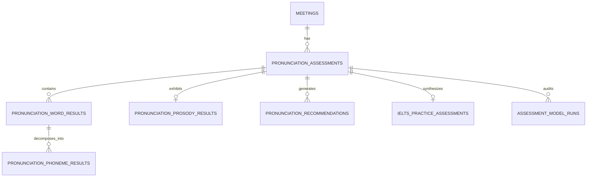

# Step 09 — Relational Database Schema & Data Models

## 1. Schema Overview & Migration

Database migration `005_pronunciation_assessment_schema.py` provisions 7 relational tables under PostgreSQL, supporting multi-tenant isolation, cascade deletion, and indexing for high-concurrency querying.

---

## 2. Table Specifications

### 2.1 `pronunciation_assessments`
Top-level assessment tracking participant acoustic evaluation state.
- `id` (UUID PK)
- `meeting_id` (FK $\rightarrow$ `meetings.id` ON DELETE CASCADE)
- `participant_id` (FK $\rightarrow$ `meeting_participants.id` ON DELETE SET NULL)
- `speaker_id` (FK $\rightarrow$ `meeting_speakers.id` ON DELETE SET NULL)
- `speaker_label` (VARCHAR 64)
- `assessment_status` (`pending`, `analyzing`, `completed`, `insufficient_evidence`, `failed`)
- `audio_quality_status` (`suitable`, `low_quality`, `insufficient_speech`, `high_noise`, `audio_missing`)
- `overall_pronunciation_score` (FLOAT, 0–100 or NULL)
- `evidence_confidence` (FLOAT, $[0.0, 1.0]$)
- `evidence_coverage` (FLOAT, $[0.0, 1.0]$)
- `evaluated_word_count` / `excluded_word_count` (INTEGER)

### 2.2 `pronunciation_word_results`
Word-level acoustic scores linked to millisecond boundaries and object storage keys.
- `id` (UUID PK), `assessment_id` (FK)
- `word_text` (VARCHAR 128)
- `start_time_ms`, `end_time_ms`, `duration_ms` (INTEGER)
- `audio_segment_reference` (VARCHAR 1024)
- `expected_phonemes` / `observed_phonetic_evidence` (VARCHAR 256)
- `pronunciation_score`, `confidence` (FLOAT)
- `evaluation_status` (`evaluated`, `excluded`, `uncertain`)

### 2.3 `pronunciation_phoneme_results`
Phoneme observations per word.
- `id` (UUID PK), `word_result_id` (FK)
- `phoneme_reference`, `phoneme_evidence` (VARCHAR 32)
- `phoneme_score`, `confidence` (FLOAT)
- `issue_type` (`correct`, `substitution`, `omission`, `distortion`, `insertion`)

### 2.4 `pronunciation_prosody_results`
Prosody, pitch features, and pause metrics.
- `assessment_id` (FK UNIQUE)
- `word_stress_score`, `sentence_stress_score`, `intonation_score`, `speaking_pace_score`, `intelligibility_score` (FLOAT)
- `pitch_features` (JSON: `mean_f0_hz`, `min_f0_hz`, `max_f0_hz`, `pitch_range_hz`, `contour_type`)
- `pause_metrics` (JSON: `total_pauses`, `avg_pause_ms`, `long_pauses_count`)

### 2.5 `ielts_practice_assessments`
CEFR/IELTS practice estimates with disclaimer.
- `assessment_id` (FK UNIQUE)
- `fluency_coherence_estimate`, `lexical_resource_estimate`, `grammatical_accuracy_estimate`, `pronunciation_estimate`, `overall_practice_estimate` (FLOAT, 0.5 increments)
- `qualitative_band_descriptor` (VARCHAR 128)
- `disclaimer_text` (TEXT NOT NULL)
