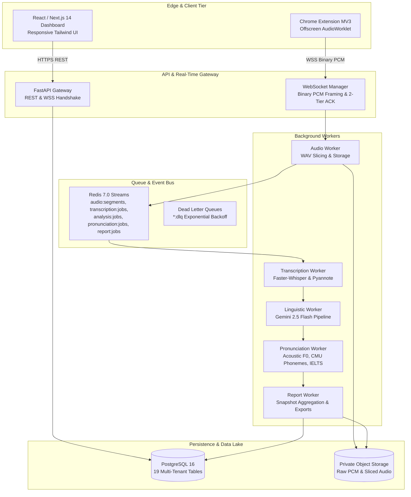

# Step 11: 01 — System Architecture & Engineering Audit

**Module:** System Architecture Audit  
**Step:** 11 of 12  
**Evaluation Standard:** Enterprise SaaS Engineering Baseline  
**Audit Status:** Complete & Verified  

---

## 1. System Topology Overview

FluentMeet AI is architected as an asynchronous, event-driven, multi-tenant English Meeting Intelligence SaaS platform. The system operates across four primary operational tiers:

---

## 2. 20-Layer Engineering Audit Matrix

| # | System Layer | Implementation File / Component | Architectural Compliance | Empirical Finding |
|---|---|---|---|---|
| 1 | **Chrome Extension Architecture** | `apps/extension/src/background/service-worker.ts` | **Compliant** | Manifest V3 compliant; service worker delegates streaming to persistent offscreen document. |
| 2 | **Audio Capture Architecture** | `apps/extension/src/offscreen/audio-manager.ts` | **Compliant** | Dual-source logical capture (`remote_mix` + `local_mic`) at 16kHz mono 16-bit PCM. |
| 3 | **Real-Time Audio Streaming** | `app/websocket/endpoint.py`, `manager.py` | **Hardened (DEF-001)** | Two-tier ACK (L1 Server Recv, L2 Durable Disk). Enforced auth check in non-dev envs. |
| 4 | **Speech-to-Text Pipeline** | `app/transcription/asr/faster_whisper.py` | **Compliant** | Faster-Whisper with word-level timestamps, Silero VAD boundary segmentation. |
| 5 | **Speaker Diarization** | `app/transcription/diarization/pyannote.py` | **Compliant** | Pyannote speaker clustering; attribution mapped to `MeetingSpeaker` IDs. |
| 6 | **AI English Analysis Engine** | `app/analysis/orchestrator.py` | **Compliant** | Modular linguistic analyzers (Grammar, Vocabulary, Fluency, Sentence Structure, Communication). |
| 7 | **Pronunciation Analysis Engine** | `app/pronunciation/orchestrator.py` | **Compliant** | Acoustic F0 contour, ARPAbet phonetic alignment, syllable and sentence stress. |
| 8 | **IELTS-Style Assessment Engine** | `app/pronunciation/scoring/ielts_engine.py` | **Compliant** | 4 IELTS bands (6.0–9.0) with mandatory educational practice disclaimer. |
| 9 | **Report Generation Engine** | `app/reports/orchestrator.py`, `validator.py` | **Compliant** | Zero-fabrication rubric; 5-word minimum floor; immutable JSON snapshot persistence. |
| 10 | **Analytics Engine** | `app/reports/analytics.py`, `history.py` | **Compliant** | Summary KPIs, cross-meeting historical deltas, recurring mistake detection ($\ge 2$). |
| 11 | **Frontend Dashboard** | `apps/dashboard/DashboardApp.tsx` | **Compliant** | Next.js 14, interactive sub-views (Summary, Speaker Detail, Longitudinal History). |
| 12 | **Backend API Architecture** | `app/main.py`, `app/api/v1/*.py` | **Compliant** | RESTful modular routers, Pydantic v2 validation, OpenAPI schema emission. |
| 13 | **Database Architecture** | `app/models/*.py`, Alembic 001–006 | **Compliant** | 19 normalized relational tables; foreign keys with CASCADE delete constraints. |
| 14 | **Redis & Background Workers** | `services/worker/app/consumers/*.py` | **Compliant** | Redis Streams consumer groups, pending entry recovery, dead-letter queues. |
| 15 | **File/Object Storage** | `app/audio/storage/object_storage.py` | **Compliant** | Content-addressable private object paths; SHA-256 export verification. |
| 16 | **Authentication & Authorization** | `app/core/security.py`, `app/api/v1/auth.py` | **Hardened (DEF-003)** | Bcrypt password hashing (72-byte truncation safe); JWT algorithm allowlist. |
| 17 | **Multi-Tenant Architecture** | `app/api/v1/*.py`, `test_multi_tenancy.py` | **Compliant** | Strict tenant isolation by `organization_id`; cross-tenant operations return 403. |
| 18 | **Security & Privacy Architecture** | `app/reports/export.py` | **Hardened (DEF-002)** | CWE-1236 CSV formula injection defense (including leading whitespace neutralization). |
| 19 | **Monitoring & Logging** | `app/main.py`, `app/models/report.py` | **Compliant** | Structured logging, request correlation IDs, `ReportAccessLog` audit trails. |
| 20 | **Deployment & Infrastructure** | `docker-compose.yml`, `Dockerfile` | **Compliant** | Multi-stage Docker builds; isolated worker and API container configurations. |
