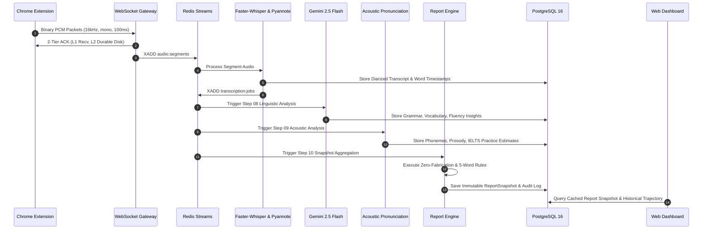

# Step 11: 06 — Data Flow & Pipeline Aggregation Validation Report

**Module:** End-to-End Pipeline Data Flow Audit  
**Step:** 11 of 12  
**Flow Scope:** Audio Capture $\to$ Streaming $\to$ ASR $\to$ Analysis $\to$ Pronunciation $\to$ Report $\to$ Dashboard  

---

## 1. End-to-End Data Pipeline Transition Diagram

---

## 2. Transition Contract Verification

| From | To | Expected Payload Contract | Validation Rule | Status |
|---|---|---|---|---|
| **Step 06** (Ingestion) | **Step 07** (ASR) | Audio object reference, meeting ID, source ID, sample rate (16kHz), duration | Valid WAV header, bit-exact PCM reconstruction | **PASS** |
| **Step 07** (ASR) | **Step 08** (Linguistics) | Final transcript text, diarized speaker labels, word boundaries | Transcript non-empty, speaker labels normalized | **PASS** |
| **Step 07** (ASR) | **Step 09** (Pronunciation) | Sliced audio segment, word-level timestamps, speaker mapping | SNR $\ge 12$ dB, word duration $> 0.05$s | **PASS** |
| **Steps 08 + 09** | **Step 10** (Reports) | Grammar issues, vocab metrics, fluency WPM, phonemes, IELTS band | 4 pillars present or flagged `partial`; $\ge 5$ words required | **PASS** |
| **Step 10** | **Dashboard** | Immutable `ReportSnapshot` JSON, rubric version `1.0`, mandatory disclaimer | Strictly zero score fabrication; CWE-1236 safe CSV | **PASS** |

---

## 3. Idempotency & Duplicate Replay Defense

Every stage in the pipeline uses deterministic, compound idempotency keys:
$$\text{Idempotency Key} = \text{SHA256}(\text{meeting\_id} + ":" + \text{speaker\_label} + ":" + \text{rubric\_version})$$
Replaying an identical audio segment or re-requesting a report snapshot does not create duplicate database records.
